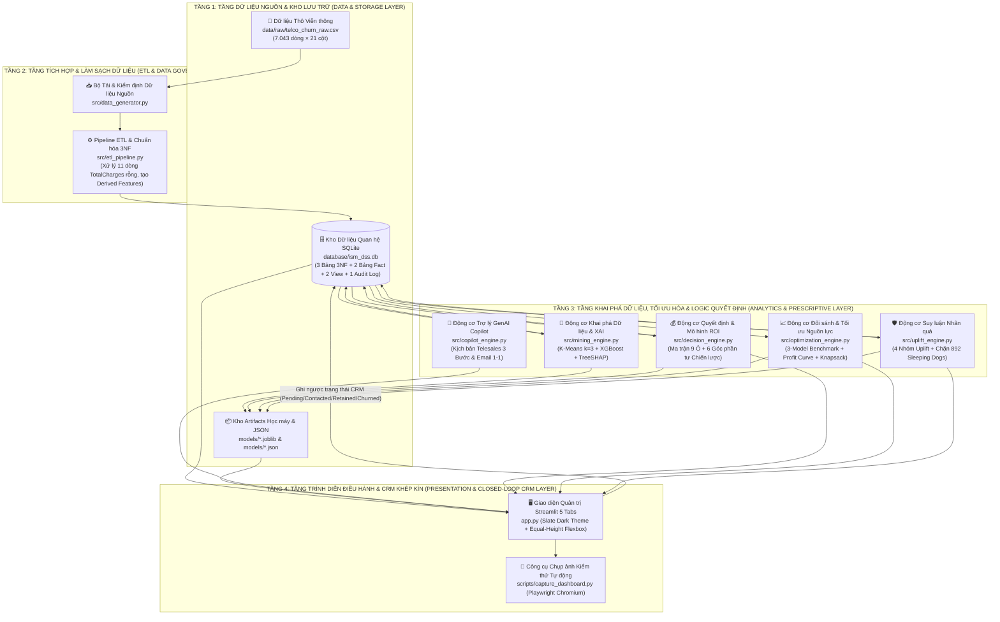

# 📘 HỒ SƠ THIẾT KẾ HỆ THỐNG & SỔ TAY HƯỚNG DẪN TOÀN DIỆN (INTERNAL KNOWLEDGE TRANSFER)

**Đề tài:** Xây dựng Ứng dụng Hỗ trợ Ra Quyết định Quản trị Giữ chân Khách hàng và Tối ưu hóa Giá trị bằng Kỹ thuật Khai phá Dữ liệu, Suy luận Nhân quả & Trí tuệ Nhân tạo Tạo sinh (*Intelligent Customer Retention & Value Optimization Decision Support System — Enterprise v3.0*)  
**Học phần:** Quản trị Hệ thống Thông tin (*Information Systems Management — ISM*)  
**Đơn vị:** Khoa Khoa học và Kỹ thuật Máy tính (*School of Computer Science and Engineering*), Trường Đại học Quốc tế — ĐHQG TP.HCM (*International University — VNU-HCM*)  

### 👥 Danh sách Thành viên Thực hiện — Nhóm 6 (Group 6)

| STT | Mã số Sinh viên | Họ và Tên | Vai trò trong Nhóm | Phụ trách Chuyên môn & Bảo vệ |
| :-: | :--- | :--- | :--- | :--- |
| 1 | **ITDSIU19048** | **Vũ Viết Phong** | Thành viên | Kiến trúc tổng thể 4 tầng, Mô hình Học máy (K-Means, XGBoost, TreeSHAP), Tối ưu hóa Knapsack & Causal Uplift |
| 2 | **ITDSIU19027** | **Trương Đăng Khoa** | Thành viên | Thiết kế Kho dữ liệu 3NF + Star Schema, Pipeline ETL (`src/etl_pipeline.py`) & Kiểm toán dữ liệu (`etl_audit_log`) |
| 3 | **ITITIU20322** | **Trần Khánh Toàn** | Thành viên | Mô hình Kinh tế học, Ma trận Quyết định 9 Ô (`src/decision_engine.py`) & Kịch bản GenAI Copilot (`src/copilot_engine.py`) |
| 4 | **ITITWE23040** | **Nguyễn Lê Mai Hương** | Thành viên | Giao diện Điều hành Streamlit 5 Tabs (`app.py`), Mô phỏng What-If, CRM Khép kín & Kiểm thử trực quan Playwright |

---

## 📑 MỤC LỤC TÀI LIỆU

1. [CHƯƠNG 1: BỨC TRANH NGHIỆP VỤ & TƯ DUY QUẢN TRỊ HỆ THỐNG (BUSINESS PROBLEM & ISM RATIONALE)](#chương-1-bức-tranh-nghiệp-vụ--tư-duy-quản-trị-hệ-thống-business-problem--ism-rationale)
2. [CHƯƠNG 2: KIẾN TRÚC HỆ THỐNG DOANH NGHIỆP 4 TẦNG (4-TIER ISM ARCHITECTURE)](#chương-2-kiến-trúc-hệ-thống-doanh-nghiệp-4-tầng-4-tier-ism-architecture)
3. [CHƯƠNG 3: BẢN THIẾT KẾ CƠ SỞ DỮ LIỆU CHUẨN DOANH NGHIỆP (3NF + STAR SCHEMA)](#chương-3-bản-thiết-kế-cơ-sở-dữ-liệu-chuẩn-doanh-nghiệp-3nf--star-schema)
4. [CHƯƠNG 4: GIẢI MÃ TOÀN BỘ CÁC THUẬT TOÁN & TRÍCH ĐOẠN CODE LÕI (CORE CODE WALKTHROUGH)](#chương-4-giải-mã-toàn-bộ-các-thuật-toán--trích-đoạn-code-lõi-core-code-walkthrough)
5. [CHƯƠNG 5: LUỒNG HOẠT ĐỘNG XUYÊN SUỐT & CẨM NANG VẤN ĐÁP HỘI ĐỒNG (END-TO-END DATA FLOW)](#chương-5-luồng-hoạt-động-xuyên-suốt--cẩm-nang-vấn-đáp-hội-đồng-end-to-end-data-flow)

---

# CHƯƠNG 1: BỨC TRANH NGHIỆP VỤ & TƯ DUY QUẢN TRỊ HỆ THỐNG (BUSINESS PROBLEM & ISM RATIONALE)

## 1.1. Nỗi đau thực tế của doanh nghiệp viễn thông (Telco Customer Churn)

Trong ngành công nghiệp viễn thông và dịch vụ thuê bao định kỳ (*Subscription Economy* — Internet cáp quang, truyền hình số, điện toán đám mây, SaaS), doanh nghiệp hoạt động dựa trên dòng tiền tái tục hàng tháng (*Monthly Recurring Revenue — MRR*). Khi thị trường đạt đến ngưỡng bão hòa, việc một khách hàng hủy hợp đồng và chuyển sang nhà mạng đối thủ (**Customer Churn / Attrition**) gây ra tổn thất kép về mặt tài chính:

1. **Chi phí thu hút khách hàng mới (Customer Acquisition Cost — CAC) đắt gấp 5 đến 7 lần chi phí giữ chân (Customer Retention Cost — CRC):** Để có một thuê bao mới, nhà mạng phải chi trả phí quảng cáo, hoa hồng đại lý, chi phí lắp đặt đường dây cáp quang, modem Wi-Fi và khuyến mãi hòa mạng. Ngược lại, giữ chân một khách hàng hiện hữu chỉ tốn chi phí chăm sóc hoặc chiết khấu gia hạn nhỏ.
2. **Mất trắng Giá trị Vòng đời Khách hàng (Customer Lifetime Value — CLV):** Khách hàng rời mạng không chỉ làm mất doanh thu tháng hiện tại mà còn xóa sổ toàn bộ dòng tiền tương lai và cơ hội bán chéo (*cross-sell*) các dịch vụ giá trị gia tăng (như bảo mật mạng `OnlineSecurity`, sao lưu đám mây `OnlineBackup`, hỗ trợ kỹ thuật ưu tiên `TechSupport`).

### 📊 Số liệu thực증 từ Kho dữ liệu của Dự án (`database/ism_dss.db`)

Trên tập dữ liệu chuẩn **IBM Telco Customer Churn** gồm **$N = 7{,}043$ thuê bao** đang quản lý trong hệ thống của chúng ta:

| Chỉ số Kinh doanh & Tài chính (Portfolio KPI) | Giá trị Thực nghiệm | Ý nghĩa Quản trị đối với Ban Giám đốc (C-Level) |
| :--- | :---: | :--- |
| **Tổng quy mô thuê bao (`total_customers`)** | **7.043 khách hàng** | Toàn bộ tập khách hàng hiện hữu đang được theo dõi trên kho dữ liệu `vw_customer_360`. |
| **Cước phí bình quân tháng (`Mean ARPU`)** | **\$64.76 / tháng** | Tạo ra dòng tiền hàng tháng \$456.116,60 cho doanh nghiệp. |
| **Tổng Doanh thu Quy đổi Năm (`Annualized Revenue`)** | **\$5.473.399,20 (~ \$5.47M)** | Tổng quy mô doanh thu hàng năm của toàn bộ danh mục ($\sum \text{MonthlyCharges}_i \times 12$). |
| **Tỷ lệ Rời mạng Quan sát (`Observed Churn Rate`)** | **26,54% (1.869 KH)** | Cứ gần 4 khách hàng thì có hơn 1 người hủy dịch vụ — mức báo động đỏ đối với nhà mạng. |
| **Tổng Doanh thu Đang gặp Rủi ro (`Revenue at Risk`)** | **\$2.445.852,11 (~ \$2.45M)** | Tương đương **44,69% tổng doanh thu năm** đang đứng trước nguy cơ bốc hơi nếu không can thiệp! |

> [!IMPORTANT]
> **Điểm nhấn khi thuyết trình trước Hội đồng:** Mặc dù tỷ lệ khách hàng rời mạng về mặt số lượng là **26,54%**, nhưng **Tổng Doanh thu Gặp rủi ro (Revenue at Risk)** lại chiếm tới **44,69% tổng doanh thu năm (\$2.45M / \$5.47M)**. Nguyên nhân là vì nhóm khách hàng sử dụng gói Cáp quang tốc độ cao (*Fiber optic*) có cước phí hàng tháng lớn (\$75 – \$118/tháng) lại chính là nhóm có xác suất rời mạng cao nhất. Nếu chỉ nhìn vào số lượng người rời bỏ mà không gắn với giá trị tiền tệ, Ban Giám đốc sẽ đánh giá sai mức độ nghiêm trọng của rủi ro!

---

## 1.2. Sai lầm chết người của cách làm truyền thống (Mass Marketing & Correlational Fallacy)

Trước khi có Hệ Hỗ trợ Ra Quyết định (DSS) của Nhóm 6, các doanh nghiệp viễn thông thường mắc phải **3 sai lầm quản trị kinh điển**:

### Sai lầm 1: Chiến dịch tiếp thị "cào bằng" (Undifferentiated Mass Marketing)
Doanh nghiệp gửi mã giảm giá 15%–20% hàng loạt cho tất cả khách hàng hoặc tặng quà ngẫu nhiên. Cách làm này dẫn đến **hiện tượng ăn mòn doanh thu tự nhiên (Discount Cannibalization)**: hàng ngàn khách hàng vốn dĩ rất trung thành (**Sure Things** — những người đã ký hợp đồng 2 năm hoặc rủi ro rời bỏ $< 20\%$) cũng nhận được mã giảm giá, làm công ty mất đi hàng trăm ngàn đô-la biên lợi nhuận mà không tạo ra bất kỳ giá trị giữ chân tăng thêm nào.

### Sai lầm 2: Bỏ tiền cứu những "Ca vô phương cứu chữa" (Lost Causes) & Khách hàng giá trị thấp
Một mô hình học máy thuần túy (chỉ dự báo xác suất Churn) sẽ báo động đỏ cho cả những khách hàng có cước phí chỉ \$19/tháng (nhóm **Low Value**) hoặc những khách hàng đã quyết tâm rời bỏ tuyệt đối ($p_{\text{churn}} > 0.85$, mới dùng 1–2 tháng và không gắn kết dịch vụ — nhóm **Lost Causes**). Nếu cử nhân viên tổng đài (tốn \$5/cuộc gọi + chiết khấu) để chèo kéo nhóm này, **chi phí bỏ ra sẽ lớn hơn số tiền thu về (ROI âm)**.

### Sai lầm 3: Đánh thức "Chó đang ngủ" (The "Sleeping Dog" Phenomenon — Hiệu ứng Nhân quả Âm)
Đây là đóng góp học thuật đắt giá nhất của phiên bản **Enterprise DSS v3.0**:
- Trong tập khách hàng có một bộ phận đang dùng hợp đồng trả theo từng tháng (`Month-to-month`), ít dịch vụ đi kèm (`VAS <= 2`), nhưng họ đang **thanh toán thụ động theo thói quen** (quán tính thanh toán).
- Nếu nhân viên Telesales bất ngờ gọi điện mời họ ký cam kết hợp đồng 1 năm hoặc nhắc đến chuyện gia hạn cước phí, cuộc gọi đó vô tình **đánh thức họ kiểm tra lại hóa đơn và đem so sánh giá với nhà mạng đối thủ**. Kết quả là họ quyết định **hủy dịch vụ ngay lập tức**!
- Trong lý thuyết Suy luận Nhân quả (*Causal Inference / Uplift Modeling*), nhóm này được gọi là **Sleeping Dogs** (hiệu ứng điều trị cá nhân $\tau_i < 0$). Trong hệ thống của chúng ta, có chính xác **892 tài khoản Sleeping Dogs** đang nắm giữ **\$195.483,60 doanh thu rủi ro** cần phải được gắn cờ **Cấm làm phiền (`is_do_not_disturb = 1`)**.

---

## 1.3. Mục tiêu của Hệ Hỗ trợ Ra Quyết định (DSS v3.0): Giải quyết 5 Câu hỏi Chiến lược

Hệ thống **ISM Customer Retention & Value Optimization DSS v3.0** không chỉ là một mô hình dự báo (Predictive Model), mà là một **Hệ thống Quản trị Khuyến nghị Hành động Khép kín (Prescriptive & Closed-Loop Decision Support System)** giải quyết trọn vẹn 5 câu hỏi của Ban Giám đốc:

| Câu hỏi Chiến lược của Nhà Quản trị | Mô-đun Giải quyết trong Hệ thống | Công nghệ & Thuật toán Lõi | Kết quả Đầu ra Cụ thể |
| :--- | :--- | :--- | :--- |
| **1. Ai là khách hàng giá trị nhất của công ty?** | Module 1 (`src/mining_engine.py`) | Học không giám sát **K-Means Clustering ($k=3$)** + `StandardScaler` | Phân hạng 7.043 KH thành 3 tầng: **High Value** (2.211 KH — \$89.34/tháng), **Medium Value** (2.708 KH — \$74.96/tháng), **Low Value** (2.124 KH — \$26.17/tháng). |
| **2. Ai sắp rời bỏ nhà mạng trong kỳ tới?** | Module 2 (`src/mining_engine.py` & `src/optimization_engine.py`) | Học có giám sát **XGBoost Classifier** (`scale_pos_weight = 2.7686`), đối sánh với Logistic Regression & Random Forest | Chấm điểm xác suất rời bỏ $p_i \in [0, 1]$ với **ROC-AUC = 0.8423**, **Recall = 77.01%**, phân tầng rủi ro `High` / `Medium` / `Low`. |
| **3. Tại sao từng khách hàng cụ thể lại muốn rời đi?** | Module 3 (`src/mining_engine.py`) | Giải thích AI **Exact TreeSHAP** (`shap.TreeExplainer`) trong không gian log-odds | Chỉ rõ 2 nguyên nhân gốc rễ lớn nhất của từng cá nhân (`top_shap_driver_1`, `top_shap_driver_2`), ví dụ: `contract=Month-to-month (+0.82)`. |
| **4. Ngân sách và nhân sự hạn hẹp thì ưu tiên cứu ai, chặn ai?** | Module 4 (`src/decision_engine.py`, `src/optimization_engine.py`, `src/uplift_engine.py`) | **Ma trận 9 Ô** + **Causal Uplift** (chặn 892 *Sleeping Dogs*) + **Thuật toán Cái túi Tham lam (Knapsack Greedy ROI)** | Tối ưu hóa phân bổ ngân sách: chỉ với **\$10.000** (34,1% ngân sách) đã thu hồi được **\$301.924,28** (**56,1% tổng lợi ích ròng tối đa**), đạt **ROI = 3.019,25%**. |
| **5. Nhân viên CSKH phải nói gì và gửi email ưu đãi gì cho từng người?** | Module 5 (`src/copilot_engine.py` & `app.py`) | **GenAI Retention Copilot** (SHAP + Causal Grounded) & **Closed-Loop CRM** | Tự động sinh **Kịch bản gọi điện 3 bước** (Hook $\rightarrow$ Empathy $\rightarrow$ Offer) và **Email Markdown cá nhân hóa 1-1**, lưu trạng thái chăm sóc trực tiếp vào SQLite. |

---

# CHƯƠNG 2: KIẾN TRÚC HỆ THỐNG DOANH NGHIỆP 4 TẦNG (4-TIER ISM ARCHITECTURE)

Hệ thống được thiết kế tuân thủ nghiêm ngặt nguyên lý **Tách biệt Mối quan tâm (Separation of Concerns — SoC)** trong kỹ thuật phần mềm doanh nghiệp, chia thành **4 tầng độc lập** giao tiếp với nhau qua giao diện dữ liệu chuẩn hóa:



### Giải thích chi tiết vai trò của từng tầng:

1. **Tầng 1 — Data & Storage Layer (`data/raw/`, `database/ism_dss.db`, `models/`):**
   - Lưu trữ tệp CSV gốc bất biến (`data/raw/telco_churn_raw.csv`) để đảm bảo khả năng tái lập thí nghiệm (*Reproducibility*).
   - Trọng tâm của Tầng 1 là cơ sở dữ liệu quan hệ nhúng **SQLite (`database/ism_dss.db`)** kết hợp kiến trúc **3NF (Third Normal Form)** cho dữ liệu giao dịch và **Star Schema (Lược đồ Hình sao)** cho dữ liệu phân tích.
   - Thư mục `models/` lưu trữ các pipeline học máy đã tuần tự hóa (`kmeans_value_pipeline.joblib`, `xgb_churn_pipeline.joblib`, `shap_metadata.joblib`) và 5 tệp JSON tổng hợp chỉ số kinh tế/mô hình để giao diện tải tức thì với độ trễ bằng 0.

2. **Tầng 2 — ETL & Data Governance Layer (`src/data_generator.py`, `src/etl_pipeline.py`):**
   - Đảm nhiệm quy trình **Extract – Transform – Load (ETL)**: kiểm tra cấu trúc tệp nguồn, làm sạch dữ liệu bẩn, kiến tạo các đặc trưng nghiệp vụ mới (*Feature Engineering*), phân rã bảng phẳng thành 3 bảng chuẩn hóa 3NF và ghi nhật ký kiểm toán vào `etl_audit_log`.

3. **Tầng 3 — Analytics, Prescriptive & Decision Logic Layer (`src/mining_engine.py`, `src/decision_engine.py`, `src/optimization_engine.py`, `src/uplift_engine.py`, `src/copilot_engine.py`):**
   - Là "bộ não" của toàn bộ hệ thống DSS, nơi hội tụ 5 lớp trí tuệ:
     1. **Descriptive/Unsupervised Mining:** Phân cụm giá trị khách hàng bằng K-Means.
     2. **Predictive Mining & XAI:** Dự báo xác suất rời mạng bằng XGBoost và giải thích nguyên nhân bằng TreeSHAP.
     3. **Prescriptive Economic Modeling:** Định lượng hóa doanh thu rủi ro, chi phí can thiệp và ROI qua Ma trận 9 Ô.
     4. **Operations Research (OR) & Profit Optimization:** Tìm ngưỡng cắt tối ưu ($p \ge 0.45$) và giải bài toán cái túi có ràng buộc ngân sách/nhân sự (Knapsack Optimizer).
     5. **Causal ML & Generative AI Copilot:** Loại trừ nhóm nhạy cảm ngược (*Sleeping Dogs*) và tự động biên soạn kịch bản đàm phán 1-1.

4. **Tầng 4 — Presentation & Closed-Loop CRM Layer (`app.py`, `scripts/capture_dashboard.py`):**
   - Cung cấp bảng điều khiển **Streamlit 5 Tabs** thiết kế theo chuẩn giao diện tài chính doanh nghiệp tối (**Enterprise Slate Dark Theme**).
   - Không chỉ hiển thị báo cáo một chiều (Read-Only BI), Tầng 4 còn cho phép nhà quản lý thực hiện **Mô phỏng độ nhạy What-If**, dự báo thuê bao mới thời gian thực và **ghi ngược kết quả chăm sóc CRM (`action_status`, `manager_notes`) trở lại cơ sở dữ liệu SQLite**, tạo thành vòng lặp phản hồi khép kín (**Closed-Loop DSS**).

---

# CHƯƠNG 3: BẢN THIẾT KẾ CƠ SỞ DỮ LIỆU CHUẨN DOANH NGHIỆP (3NF + STAR SCHEMA)

## 3.1. Tại sao phải kết hợp Chuẩn hóa 3NF và Lược đồ Hình sao (Hybrid 3NF + Star Schema)?

Khi hội đồng hỏi *"Tại sao nhóm không đọc thẳng từ file CSV vào Pandas mà phải xây dựng cơ sở dữ liệu SQLite gồm 6 bảng và 2 View?"*, các thành viên Nhóm 6 cần trả lời rõ 3 lý do cốt lõi của môn **Information Systems Management**:

1. **Chống dư thừa và dị thường dữ liệu (Eliminating Data Redundancy & Update Anomalies — 3NF):** Trong file CSV phẳng ban đầu, thông tin nhân khẩu học, thông tin gói cước kỹ thuật và thông tin hợp đồng thanh toán bị trộn lẫn. Bằng cách tách thành 3 bảng thực thể chuẩn hóa bậc 3 (`customers`, `service_subscriptions`, `billing_contracts`) liên kết qua khóa chính – khóa ngoại `customerID`, hệ thống đảm bảo mỗi miền nghiệp vụ (Quản lý hồ sơ KH, Quản lý kỹ thuật nhà mạng, Quản lý kế toán cước) được tách biệt rõ ràng.
2. **Lưu trữ tách biệt Điểm số Học máy và Hành động Kinh doanh (Fact Tables — Star Schema):** Kết quả chạy mô hình AI (`fact_mining_scores`) và kế hoạch phân bổ ngân sách/trạng thái CRM (`fact_retention_actions`) là các bảng sự kiện phát sinh theo thời gian. Việc tách riêng 2 bảng Fact giúp công ty có thể cập nhật lại chính sách giá (chạy lại `decision_engine.py`) mà không cần huấn luyện lại mô hình XGBoost, hoặc cập nhật trạng thái CRM từng khách hàng mà không chạm vào dữ liệu gốc.
3. **Đảm bảo Toàn vẹn Tham chiếu & Kiểm toán Hệ thống (Referential Integrity & Data Governance):** Mọi bảng con đều gắn ràng buộc `FOREIGN KEY (customerID) REFERENCES customers(customerID) ON DELETE CASCADE` và ràng buộc miền giá trị `CHECK (...)`. Bảng `etl_audit_log` lưu vết từng lần nạp dữ liệu với cam kết **0 lỗi khóa ngoại (`fk_violations = 0`)** và **0 lỗi giá trị rỗng (`null_violations = 0`)**.

---

## 3.2. Sơ đồ Thực thể – Liên kết (Entity-Relationship Diagram — ERD)

```mermaid
erDiagram
    CUSTOMERS ||--|| SERVICE_SUBSCRIPTIONS : "đăng ký (1:1)"
    CUSTOMERS ||--|| BILLING_CONTRACTS : "thanh toán (1:1)"
    CUSTOMERS ||--o| FACT_MINING_SCORES : "được chấm điểm AI (1:1)"
    CUSTOMERS ||--o| FACT_RETENTION_ACTIONS : "nhận quyết định & CRM (1:1)"

    CUSTOMERS {
        TEXT customerID PK "Mã định danh thuê bao duy nhất"
        TEXT gender "Giới tính ('Male', 'Female')"
        INTEGER senior_citizen "Người cao tuổi (0, 1)"
        INTEGER partner "Có bạn đời (0, 1)"
        INTEGER dependents "Có người phụ thuộc (0, 1)"
        INTEGER tenure "Số tháng gắn bó (>= 0)"
        TEXT tenure_group "Nhóm vòng đời ('0-12m', '13-24m', '25-48m', '49-60m', '61m+')"
    }

    SERVICE_SUBSCRIPTIONS {
        TEXT customerID PK, FK "Tham chiếu customers(customerID)"
        INTEGER phone_service "Dịch vụ thoại cố định (0, 1)"
        TEXT multiple_lines "Đa đường dây thoại"
        TEXT internet_service "Loại kết nối ('DSL', 'Fiber optic', 'No')"
        TEXT online_security "Bảo mật mạng (VAS #1)"
        TEXT online_backup "Sao lưu đám mây (VAS #2)"
        TEXT device_protection "Bảo hiểm thiết bị (VAS #3)"
        TEXT tech_support "Hỗ trợ kỹ thuật VIP (VAS #4)"
        TEXT streaming_tv "Truyền hình trực tuyến (VAS #5)"
        TEXT streaming_movies "Phim trực tuyến (VAS #6)"
        INTEGER total_services_count "Tổng số dịch vụ VAS đang bật (0..6)"
    }

    BILLING_CONTRACTS {
        TEXT customerID PK, FK "Tham chiếu customers(customerID)"
        TEXT contract "Loại hợp đồng ('Month-to-month', 'One year', 'Two year')"
        INTEGER paperless_billing "Hóa đơn điện tử (0, 1)"
        TEXT payment_method "Phương thức thanh toán"
        INTEGER is_auto_payment "Thanh toán tự động AutoPay (0, 1)"
        REAL monthly_charges "Cước phí hàng tháng ($)"
        REAL total_charges "Tổng cước phí lũy kế ($)"
        REAL avg_monthly_spend "Chi tiêu bình quân tháng thực tế ($)"
        TEXT churn_label "Nhãn rời bỏ gốc ('Yes', 'No')"
        INTEGER churn_binary "Biến mục tiêu nhị phân (0, 1)"
    }

    FACT_MINING_SCORES {
        TEXT customerID PK, FK "Tham chiếu customers(customerID)"
        TEXT value_tier "Phân hạng giá trị K-Means ('High', 'Medium', 'Low')"
        INTEGER cluster_id "Chỉ số cụm K-Means (0, 1, 2)"
        REAL churn_probability "Xác suất rời bỏ XGBoost [0.0..1.0]"
        TEXT risk_level "Mức độ rủi ro ('High', 'Medium', 'Low')"
        TEXT top_shap_driver_1 "Nhân tố rủi ro SHAP số 1 (log-odds)"
        TEXT top_shap_driver_2 "Nhân tố rủi ro SHAP số 2 (log-odds)"
        TEXT scored_at "Dấu thời gian chấm điểm ISO-8601"
    }

    FACT_RETENTION_ACTIONS {
        TEXT customerID PK, FK "Tham chiếu customers(customerID)"
        REAL annualized_revenue "Doanh thu quy đổi năm ($)"
        REAL revenue_at_risk "Doanh thu có nguy cơ mất ($)"
        TEXT decision_quadrant "Góc phần tư chiến lược (6 nhóm)"
        TEXT recommended_action "Kịch bản ưu đãi khuyến nghị"
        REAL intervention_cost "Chi phí can thiệp kỳ vọng ($)"
        REAL expected_saved_revenue "Doanh thu cứu được kỳ vọng ($)"
        REAL expected_net_benefit "Lợi ích tài chính ròng kỳ vọng ($)"
        REAL expected_roi "Tỷ suất hoàn vốn kỳ vọng (%)"
        REAL uplift_score "Điểm tác động nhân quả tau [-0.45..+0.55]"
        TEXT causal_segment "Phân khúc nhân quả ('Persuadable', 'Sleeping Dog', ...)"
        INTEGER is_do_not_disturb "Cờ cấm làm phiền DND (0, 1)"
        TEXT decided_at "Thời điểm ra quyết định ISO-8601"
        TEXT action_status "Trạng thái CRM ('Pending', 'Contacted', 'Retained', 'Churned')"
        TEXT manager_notes "Ghi chú của Account Manager"
        TEXT updated_at "Thời điểm cập nhật CRM gần nhất"
    }
```



---

## 3.3. Giải thích Chi tiết Ý nghĩa Nghiệp vụ của Từng Bảng & View

### 1. Nhóm 3 Bảng Chiều Chuẩn hóa Bậc 3 (3NF Dimension Tables)
- **Bảng `customers` (7.043 dòng × 7 cột):** Quản lý hồ sơ nhân khẩu học và thâm niên của thuê bao. Cột đặc trưng dẫn xuất `tenure_group` chia vòng đời khách hàng thành 5 giai đoạn (`0-12m`, `13-24m`, `25-48m`, `49-60m`, `61m+`), giúp phát hiện quy luật: nhóm mới hòa mạng `0-12m` có tỷ lệ rời bỏ lên tới **47,44%**, trong khi nhóm gắn bó trên 5 năm `61m+` chỉ có tỷ lệ rời bỏ **6,61%**.
- **Bảng `service_subscriptions` (7.043 dòng × 11 cột — đóng vai trò bảng `services`):** Quản lý hạ tầng kết nối (`phone_service`, `multiple_lines`, `internet_service`) và 6 dịch vụ giá trị gia tăng (VAS). Cột dẫn xuất `total_services_count` (từ `0` đến `6`) đo lường **Độ gắn kết Hệ sinh thái (Ecosystem Lock-in / Switching Cost)**: khách hàng càng dùng nhiều dịch vụ VAS thì chi phí chuyển đổi nhà mạng càng lớn, giúp giảm mạnh nguy cơ rời bỏ.
- **Bảng `billing_contracts` (7.043 dòng × 10 cột — đóng vai trò bảng `billing`):** Quản lý điều khoản thương mại và dòng tiền. Bổ sung 2 cột dẫn xuất quan trọng là `is_auto_payment` (`1` nếu thanh toán tự động qua ngân hàng/thẻ tín dụng, `0` nếu trả thủ công bằng séc điện tử/thư) và `avg_monthly_spend` (chi tiêu thực tế trung bình mỗi tháng).

### 2. Nhóm 2 Bảng Sự kiện Phân tích (Analytical Fact Tables)
- **Bảng `fact_mining_scores` (7.043 dòng × 8 cột):** Lưu trữ đầu ra của Tầng Khai phá Dữ liệu (`src/mining_engine.py`), bao gồm phân hạng giá trị K-Means (`value_tier`, `cluster_id`), xác suất rời mạng từ XGBoost (`churn_probability`, `risk_level`) và 2 nguyên nhân gốc rễ từ TreeSHAP (`top_shap_driver_1`, `top_shap_driver_2`).
- **Bảng `fact_retention_actions` (7.043 dòng × 16 cột):** Lưu trữ đầu ra của Tầng Ra Quyết định Khuyến nghị (`src/decision_engine.py`), Tầng Suy luận Nhân quả (`src/uplift_engine.py`) và Tầng CRM Khép kín (`app.py`). Đây là bảng phục vụ trực tiếp cho hoạt động vận hành hàng ngày của đội ngũ Account Manager.

### 3. Hai View Hợp nhất (`customer_master`, `vw_customer_360`) và Bảng Kiểm toán (`etl_audit_log`)
- **View `customer_master` (26 cột):** Hợp nhất 3 bảng 3NF (`customers` $\bowtie$ `service_subscriptions` $\bowtie$ `billing_contracts`) thành một bảng chuẩn hóa sạch sẽ để làm đầu vào huấn luyện cho `mining_engine.py`.
- **View `vw_customer_360` (47 cột):** Là "Trái tim dữ liệu" của Dashboard `app.py`, kết nối toàn bộ 3 bảng 3NF với 2 bảng Fact (`fact_mining_scores` và `fact_retention_actions`). Chỉ cần một câu truy vấn `SELECT * FROM vw_customer_360`, ứng dụng có ngay góc nhìn 360 độ từ nhân khẩu học, gói cước, hóa đơn, điểm AI, giải thích SHAP, phân khúc nhân quả cho tới trạng thái chăm sóc CRM!
- **Bảng `etl_audit_log` (9 cột):** Ghi nhận lịch sử chạy ETL (`run_id`, `run_timestamp`, `source_file`, `rows_extracted`, `rows_loaded`, `blank_total_charges_fixed`, `fk_violations`, `null_violations`, `status`), chứng minh tính minh bạch và chuẩn mực Quản trị Dữ liệu (*Data Governance*) trên Tab 5 của Dashboard.

---

# CHƯƠNG 4: GIẢI MÃ TOÀN BỘ CÁC THUẬT TOÁN & TRÍCH ĐOẠN CODE LÕI (CORE CODE WALKTHROUGH)

Chương này đi sâu vào từng tệp mã nguồn trong thư mục `src/` và `app.py`, trích dẫn các đoạn code quan trọng nhất và giải thích cặn kẽ từng dòng để mọi thành viên trong nhóm đều có thể tự tin giải thích khi giảng viên hỏi bất kỳ dòng code nào.

---

## 4.1. Pipeline ETL & Chuẩn hóa Dữ liệu — [`src/etl_pipeline.py`](file:///d:/HCMIU/Information%20System%20Mangage/project/ISM-project/src/etl_pipeline.py)

### A. Xử lý 11 dòng chuỗi khoảng trắng `" "` ở cột `TotalCharges` & Tạo Đặc trưng Dẫn xuất

Trong tệp dữ liệu gốc `telco_churn_raw.csv`, cột `TotalCharges` bị lưu dưới dạng chuỗi ký tự (`object`) vì có **11 bản ghi chứa chuỗi khoảng trắng `" "`** thay vì con số. Hãy xem cách hàm [`transform`](file:///d:/HCMIU/Information%20System%20Mangage/project/ISM-project/src/etl_pipeline.py#L194-L273) xử lý:

```python
# Trích từ src/etl_pipeline.py (Dòng 221 - 249)
total_num = pd.to_numeric(df["TotalCharges"].astype(str).str.strip(), errors="coerce")
blank_mask = total_num.isna()
blank_count = int(blank_mask.sum())
# Toàn bộ các dòng có TotalCharges rỗng đều là thuê bao mới hòa mạng (tenure == 0) -> gán 0.0
df["total_charges"] = total_num.fillna(0.0).astype(float)

# 2. Nhóm thâm niên vòng đời khách hàng (tenure_group)
df["tenure"] = df["tenure"].astype(int)
df["tenure_group"] = pd.cut(
    df["tenure"], bins=TENURE_BINS, labels=TENURE_LABELS, right=True
).astype(str)

# 3. Đếm tổng số dịch vụ giá trị gia tăng (VAS) đang kích hoạt (0..6)
df["total_services_count"] = (
    df[VAS_COLS].apply(lambda col: (col == "Yes").astype(int)).sum(axis=1).astype(int)
)

# 4. Cờ thanh toán tự động (is_auto_payment) và chi tiêu trung bình tháng (avg_monthly_spend)
df["is_auto_payment"] = df["PaymentMethod"].isin(AUTO_PAYMENT_METHODS).astype(int)
df["monthly_charges"] = df["MonthlyCharges"].astype(float)
df["avg_monthly_spend"] = np.where(
    df["tenure"] > 0,
    np.round(df["total_charges"] / df["tenure"], 2),
    df["monthly_charges"],
)
```

**💡 Giải thích Logic Kinh tế & Kỹ thuật (Dành cho Vấn đáp):**
- **Tại sao không xóa (`dropna`) 11 dòng này mà lại gán bằng `0.0`?**  
  Khi kiểm tra dữ liệu, cả 11 khách hàng có `TotalCharges == " "` đều có **`tenure == 0`** (tức là khách hàng vừa mới ký hợp đồng trong tháng đầu tiên, chưa phát sinh kỳ chốt sổ hóa đơn lũy kế nào). Nếu dùng `dropna()` xóa mất 11 dòng này, mô hình sẽ **mất hoàn toàn khả năng học hành vi của khách hàng vừa mới gia nhập (`tenure = 0`)**. Về mặt kế toán, khách hàng chưa qua kỳ thanh toán đầu tiên có tổng phí lũy kế bằng `0.0` là chính xác tuyệt đối!
- **Tại sao khi tính `avg_monthly_spend` lại dùng `np.where(df["tenure"] > 0, ...)`?**  
  Để tránh lỗi chia cho 0 (`ZeroDivisionError`) đối với chính 11 khách hàng có `tenure == 0`. Khi `tenure == 0`, chi tiêu trung bình tháng của họ được gán bằng chính gói cước cam kết hàng tháng `monthly_charges`.

### B. Cơ chế Transaction Nguyên tử (Atomic SQLite Transaction) & Kiểm tra Khóa ngoại

```python
# Trích từ src/etl_pipeline.py (Dòng 298 - 327)
conn = sqlite3.connect(db_path)
try:
    conn.execute("PRAGMA foreign_keys = ON;")
    conn.executescript(DDL_SCRIPT)

    with conn:  # Giao dịch nguyên tử (Atomic Transaction): thành công toàn bộ hoặc rollback toàn bộ
        # Xóa bảng con trước, bảng cha sau để tuân thủ ràng buộc khóa ngoại (Foreign Keys)
        conn.execute("DELETE FROM fact_retention_actions;")
        conn.execute("DELETE FROM fact_mining_scores;")
        conn.execute("DELETE FROM billing_contracts;")
        conn.execute("DELETE FROM service_subscriptions;")
        conn.execute("DELETE FROM customers;")

        conn.executemany(
            f"INSERT INTO customers ({', '.join(cust_cols)}) VALUES ({', '.join(['?']*len(cust_cols))});",
            df[cust_cols].itertuples(index=False, name=None),
        )
```

**💡 Giải thích Kỹ thuật:**
- Mặc định trong SQLite, kiểm tra khóa ngoại bị tắt. Lệnh `conn.execute("PRAGMA foreign_keys = ON;")` bắt buộc cơ sở dữ liệu kiểm tra nghiêm ngặt mọi ràng buộc khóa ngoại.
- Khối `with conn:` tạo ra một **Giao dịch Nguyên tử (ACID Transaction)**: nếu bất kỳ lệnh `INSERT` nào gặp lỗi giữa chừng, SQLite sẽ tự động `ROLLBACK` hoàn toàn để kho dữ liệu không bao giờ rơi vào trạng thái lỗi một nửa.

---

## 4.2. Động cơ Khai phá Dữ liệu & Giải thích AI — [`src/mining_engine.py`](file:///d:/HCMIU/Information%20System%20Mangage/project/ISM-project/src/mining_engine.py)

### A. Module 1: Phân hạng Giá trị Kinh tế bằng K-Means ($k=3$)

```python
# Trích từ src/mining_engine.py (Dòng 141 - 178)
X = df[VALUE_FEATURES].astype(float)
X_scaled = StandardScaler().fit_transform(X)

# Quét k = 2..6 để ghi nhận chỉ số kiểm định Silhouette
silhouettes = {}
for k in SILHOUETTE_K_RANGE:
    labels_k = KMeans(n_clusters=k, random_state=RANDOM_STATE, n_init=10).fit_predict(X_scaled)
    silhouettes[k] = float(silhouette_score(X_scaled, labels_k, random_state=RANDOM_STATE))

pipeline = Pipeline([
    ("scaler", StandardScaler()),
    ("kmeans", KMeans(n_clusters=N_CLUSTERS, random_state=RANDOM_STATE, n_init=10)),
])
cluster_ids = pipeline.fit_predict(X)
```

**💡 Tại sao chọn $k=3$ khi Silhouette ở $k=2$ là `0.459` còn ở $k=3$ là `0.402`?**
- Khi quét $k \in \{2, 3, 4, 5, 6\}$, hệ số Silhouette đạt `k=2: 0.459`, `k=3: 0.402`, `k=4: 0.396`, `k=5: 0.376`, `k=6: 0.365`.
- Ở $k=2$, thuật toán chỉ tách khách hàng thành 2 nhóm thô (Chi tiêu Cao vs. Chi tiêu Thấp), làm gộp chung nhóm khách hàng **Tăng trưởng / Trung cấp (Medium Value — cước cao \$74.96/tháng nhưng mới dùng 15.3 tháng, tỷ lệ rời bỏ cực cao 45.6%)** với nhóm khách hàng **VIP Lâu năm (High Value — cước \$89.34/tháng, đã gắn bó 58.4 tháng, tỷ lệ rời bỏ chỉ 14.7%)**.
- Chọn **$k=3$** vừa duy trì độ phân tách hình học rất tốt (`Silhouette = 0.402 > 0.40`), vừa khớp hoàn hảo với **Ma trận Quản trị 3 Tầng Giá trị (`High` / `Medium` / `Low`)**:

| Phân hạng Giá trị (`value_tier`) | Cụm K-Means (`cluster_id`) | Số lượng KH | Thâm niên TB (`tenure`) | Cước tháng TB (`monthly_charges`) | Tổng cước lũy kế TB (`total_charges`) | Số dịch vụ VAS TB | Tỷ lệ Rời mạng (`churn_rate`) | Tỷ trọng Doanh thu (`revenue_share`) |
| :--- | :-: | :-: | :-: | :-: | :-: | :-: | :-: | :-: |
| **High Value** | Cluster 0 | 2.211 | 58,4 tháng | \$89,34 | \$5.207,53 | 3,98 / 6 | 14,74% | **43,31%** |
| **Medium Value** | Cluster 2 | 2.708 | 15,3 tháng | \$74,96 | \$1.143,36 | 1,89 / 6 | **45,61%** | **44,51%** |
| **Low Value** | Cluster 1 | 2.124 | 27,0 tháng | \$26,17 | \$680,84 | 0,20 / 6 | 14,50% | **12,19%** |

### B. Module 2: Dự báo Rời mạng bằng XGBoost & Chống Rò rỉ Dữ liệu (Leakage-Free Pipeline)

```python
# Trích từ src/mining_engine.py (Dòng 199 - 226)
def build_churn_pipeline(scale_pos_weight: float) -> Pipeline:
    preprocessor = ColumnTransformer([
        ("cat", OneHotEncoder(handle_unknown="ignore", sparse_output=False), CATEGORICAL_FEATURES),
        ("num", StandardScaler(), NUMERIC_FEATURES),
    ])
    model = XGBClassifier(scale_pos_weight=scale_pos_weight, **XGB_PARAMS)
    return Pipeline([("preprocessor", preprocessor), ("model", model)])
```

**💡 Giải thích 2 Kỹ thuật Học máy Quan trọng nhất trong đoạn code trên:**
1. **Chống Rò rỉ Dữ liệu (Anti-Data Leakage) bằng `Pipeline` + `ColumnTransformer`:**  
   Nếu chuẩn hóa `StandardScaler` hoặc mã hóa `OneHotEncoder` trên toàn bộ 7.043 dòng trước khi chia `train_test_split`, thông tin trung bình/phương sai của tập Test sẽ bị rò rỉ vào tập Train. Việc gói `ColumnTransformer` vào bên trong `Pipeline` đảm bảo khi gọi `eval_pipeline.fit(X_train, y_train)`, các bộ biến đổi chỉ học từ 5.634 mẫu Train. Hơn nữa, tham số `handle_unknown="ignore"` giúp hệ thống không bao giờ bị văng lỗi khi chấm điểm khách hàng mới ở Tab 4.
2. **Xử lý Mất cân bằng Lớp (Class Imbalance) bằng `scale_pos_weight = 2.7686`:**  
   Trong tập huấn luyện (5.634 mẫu), số người ở lại (`y=0`) là 4.139 người (73,46%), còn số người rời bỏ (`y=1`) chỉ có 1.495 người (26,54%). Tỷ số cân bằng trọng số lớp dương được tính chính xác bằng:
   $$\text{scale\_pos\_weight} = \frac{N_{\text{negative}}}{N_{\text{positive}}} = \frac{4{,}139}{1{,}495} \approx 2.7686$$
   Nhờ trọng số này, mỗi khi mô hình bỏ sót một khách hàng rời bỏ (False Negative), hàm mất mát Log-Loss sẽ phạt nặng gấp **2,77 lần**, giúp **Độ nhạy (Recall) trên tập Test đạt tới 77,01%** (bắt trúng 288 / 374 khách hàng thực sự rời mạng).

### C. Module 3: Giải thích Mô hình Hộp đen bằng Exact TreeSHAP (Log-Odds Attribution)

```python
# Trích từ src/mining_engine.py (Dòng 371 - 379)
values, base, method = compute_shap_values(pipeline, X)
mapping = encoded_to_original_mapping(pipeline)
encoded_names = list(pipeline.named_steps["preprocessor"].get_feature_names_out())

# Cộng gộp giá trị SHAP của các cột One-Hot cùng thuộc một thuộc tính gốc (tính chất cộng tính của SHAP)
shap_by_feature = (pd.DataFrame(values, columns=encoded_names)
                     .T.groupby(np.array(mapping)).sum().T)[MODEL_FEATURES]
global_importance = shap_by_feature.abs().mean().sort_values(ascending=False)
driver_1, driver_2 = extract_top_drivers(shap_by_feature, X, top_n=2)
```

**💡 Tại sao phải cộng gộp (`groupby(mapping).sum()`) các cột One-Hot SHAP?**
- Khi biến `contract` (gồm 3 giá trị: `Month-to-month`, `One year`, `Two year`) đi qua `OneHotEncoder`, nó bị tách thành 3 cột nhị phân riêng biệt.
- Nhờ **Tính chất Cộng tính Cục bộ (Local Accuracy / Additivity)** của giá trị Shapley:
  $$f(x_i) = \phi_0 + \sum_{j=1}^{M} \phi_{ij} \quad \text{(trong không gian log-odds)}$$
  tổng đóng góp SHAP của 3 cột One-Hot con chính bằng đóng góp SHAP thực sự của thuộc tính nghiệp vụ gốc `contract`.
- Sau khi cộng gộp về 23 thuộc tính gốc, hàm `extract_top_drivers` tìm ra 2 thuộc tính có $\phi_{ij} > 0$ lớn nhất của từng khách hàng và định dạng thành chuỗi dễ hiểu cho nhà quản lý, ví dụ: `"contract=Month-to-month (+0.82)"` và `"internet_service=Fiber optic (+0.41)"`.

---

## 4.3. Động cơ Ra Quyết định & Mô hình Kinh tế ROI — [`src/decision_engine.py`](file:///d:/HCMIU/Information%20System%20Mangage/project/ISM-project/src/decision_engine.py)

### A. Ma trận Quyết định 9 Ô (9-Cell Value × Risk Decision Matrix)

Hệ thống kết hợp 3 phân hạng giá trị K-Means (`High`, `Medium`, `Low`) với 3 mức độ rủi ro XGBoost (`High` $\ge 0.60$, `Medium` $\in [0.30, 0.60)$, `Low` $< 0.30$) để tạo thành **Ma trận 9 Ô** ánh xạ vào **6 Góc phần tư Chiến lược**:

| Phân hạng Giá trị \ Mức độ Rủi ro | **High Risk ($p \ge 0.60$)** | **Medium Risk ($0.30 \le p < 0.60$)** | **Low Risk ($p < 0.30$)** |
| :--- | :--- | :--- | :--- |
| **High Value**<br/>*(2.211 KH — \$89.34/th)* | 🔴 **Ô 1: Critical VIP Retention**<br/>• **266 KH** \| RaR: **\$222,57K**<br/>• Kênh: Gọi 1-1 (\$5) + Giảm 20% (3 tháng)<br/>• Tỷ lệ thành công $s = 45\%$<br/>• **ROI = 1.073,89%** | 🟠 **Ô 2: Proactive VIP Care**<br/>• **550 KH** \| RaR: **\$284,66K**<br/>• Kênh: Gọi 1-1 (\$5) + Giảm 10% (3 tháng)<br/>• Tỷ lệ thành công $s = 36\%$<br/>• **ROI = 1.108,33%** | 🟢 **Ô 3: Champions / Nurture**<br/>• **1.395 KH** \| RaR: \$156,46K<br/>• Kênh: Chăm sóc tự nhiên (\$0)<br/>• Không tốn ngân sách giữ chân |
| **Medium Value**<br/>*(2.708 KH — \$74.96/th)* | 🟠 **Ô 4: Automated Retention Campaign**<br/>• **1.658 KH** \| RaR: **\$1.293,82K**<br/>• Kênh: Email/SMS (\$0.50) + Voucher 10%<br/>• Tỷ lệ thành công $s = 25\%$<br/>• **ROI = 2.884,40%** | 🟡 **Ô 5: Targeted Nudge**<br/>• **626 KH** \| RaR: **\$238,71K**<br/>• Kênh: Email/SMS (\$0.50) + Voucher 5%<br/>• Tỷ lệ thành công $s = 17,5\%$<br/>• **ROI = 2.798,45%** | 🟢 **Ô 6: Champions / Nurture**<br/>• **424 KH** \| RaR: \$56,36K<br/>• Kênh: Chăm sóc tự nhiên (\$0)<br/>• Không tốn ngân sách giữ chân |
| **Low Value**<br/>*(2.124 KH — \$26.17/th)* | ⚪ **Ô 7: No Financial Intervention**<br/>• **338 KH** \| RaR: \$103,03K<br/>• Kênh: Khảo sát tự động (\$0) | ⚪ **Ô 8: No Financial Intervention**<br/>• **367 KH** \| RaR: \$57,09K<br/>• Kênh: Khảo sát tự động (\$0) | 🟢 **Ô 9: Champions / Nurture**<br/>• **1.419 KH** \| RaR: \$33,15K<br/>• Kênh: Chăm sóc tự nhiên (\$0) |

### B. Hệ thống Công thức Kinh tế học Lượng hóa (Prescriptive Economic Formulation)

Đối với mỗi khách hàng thứ $i \in \{1, \dots, 7043\}$, hàm [`run_decision_simulation`](file:///d:/HCMIU/Information%20System%20Mangage/project/ISM-project/src/decision_engine.py#L186-L315) tính toán 6 đại lượng tài chính theo công thức toán học chặt chẽ:

1. **Doanh thu Quy đổi Năm (Annualized Revenue):**
   $$\text{Annualized Revenue}_i = \text{MonthlyCharges}_i \times 12$$
2. **Doanh thu Có Nguy cơ Mất (Expected Revenue at Risk — RaR):**
   $$\text{Revenue at Risk}_i = p_{\text{churn}, i} \times \text{Annualized Revenue}_i$$
3. **Chi phí Can thiệp Kỳ vọng (Expected Intervention Cost):**
   $$\text{Intervention Cost}_i = C_{\text{channel}, i} + s_i \times \left(\delta_i \times \text{MonthlyCharges}_i \times 3\right)$$
   > **Giải thích bản chất kinh tế cực kỳ quan trọng:** Tại sao phần tiền giảm giá $\left(\delta_i \times \text{MonthlyCharges}_i \times 3\right)$ lại được nhân với xác suất giữ chân thành công $s_i$? Bởi vì chi phí cuộc gọi hoặc tin nhắn ($C_{\text{channel}, i} = \$5.00$ hoặc $\$0.50$) là **chi phí chìm phát sinh ngay khi liên hệ** cho mọi khách hàng mục tiêu; nhưng **khoản chiết khấu cước 3 tháng chỉ thực sự phát sinh trên hóa đơn khi khách hàng đồng ý ở lại** (với xác suất $s_i$)!
4. **Doanh thu Kỳ vọng Cứu được (Expected Saved Revenue):**
   $$\text{Expected Saved Revenue}_i = \text{Revenue at Risk}_i \times s_i$$
5. **Lợi ích Tài chính Ròng Kỳ vọng (Expected Net Benefit):**
   $$\text{Expected Net Benefit}_i = \text{Expected Saved Revenue}_i - \text{Intervention Cost}_i$$
6. **Tỷ suất Hoàn vốn Kỳ vọng (Expected ROI %):**
   $$\text{Expected ROI}_i\,(\%) = \begin{cases} \dfrac{\text{Expected Saved Revenue}_i - \text{Intervention Cost}_i}{\text{Intervention Cost}_i} \times 100\% & \text{nếu } \text{Intervention Cost}_i > 0 \\ 0\% & \text{nếu } \text{Intervention Cost}_i = 0 \end{cases}$$

```python
# Trích từ src/decision_engine.py (Dòng 270 - 291)
# Chi phí can thiệp kỳ vọng c_i = Chi phí kênh liên hệ ban đầu + Kỳ vọng giá trị chiết khấu được quy đổi
cost_hh = call_cost + sr_vip * (monthly * high_disc * disc_months)
cost_hm = call_cost + (sr_vip * 0.80) * (monthly * (high_disc * 0.50) * disc_months)
cost_mh = email_cost + sr_auto * (monthly * med_disc * disc_months)
cost_mm = email_cost + (sr_auto * 0.70) * (monthly * (med_disc * 0.50) * disc_months)

intervention_cost = np.round(
    np.select([cond_hh, cond_hm, cond_mh, cond_mm], [cost_hh, cost_hm, cost_mh, cost_mm], default=0.0),
    2,
)

# Tính Doanh thu cứu được kỳ vọng, Lợi ích ròng (Net Benefit) và Tỷ suất ROI (%)
expected_saved_revenue = np.round(revenue_at_risk * success_rate, 2)
expected_net_benefit = np.round(expected_saved_revenue - intervention_cost, 2)
```

---

## 4.4. Đối sánh Đa Mô hình, Đường cong Lợi nhuận & Tối ưu hóa Nguồn lực Knapsack — [`src/optimization_engine.py`](file:///d:/HCMIU/Information%20System%20Mangage/project/ISM-project/src/optimization_engine.py)

### A. Bảng Đối sánh Thực nghiệm 3 Mô hình Học máy (`models/model_benchmark.json`)

Để chứng minh việc chọn **XGBoost** làm mô hình triển khai chính (*Champion Model*) là hoàn toàn khách quan, hàm [`run_model_benchmark`](file:///d:/HCMIU/Information%20System%20Mangage/project/ISM-project/src/optimization_engine.py#L152-L254) huấn luyện và đánh giá 3 kiến trúc trên cùng tập kiểm thử Stratified Hold-out ($n_{\text{train}} = 5{,}634$, $n_{\text{test}} = 1{,}409$):

| Mô hình Học máy | Vai trò | Test ROC-AUC | Test PR-AUC | Recall (Độ nhạy) | Precision | F1-Score | Accuracy | Brier Score (Hiệu chỉnh) | Train ROC-AUC | Thời gian Train |
| :--- | :-: | :-: | :-: | :-: | :-: | :-: | :-: | :-: | :-: | :-: |
| **Logistic Regression** | Baseline tuyến tính | 0.8440 | 0.6671 | 79,14% | 51,03% | 0.6205 | 74,31% | 0.1656 | 0.8501 | 0,066s |
| **Random Forest** | Bagging Ensemble | 0.8456 | 0.6664 | 76,47% | 54,48% | 0.6363 | 76,79% | 0.1564 | 0.8950 | 0,787s |
| **XGBoost (Champion)** | **Mô hình Triển khai** | **0.8423** | **0.6651** | **77,01%** | **52,84%** | **0.6268** | **75,66%** | **0.1612** | **0.9038** | **0,789s** |

**💡 Lý giải vì sao chọn XGBoost làm Champion Model:**
1. **Cân bằng tối ưu giữa Độ nhạy phát hiện rời mạng (`Recall = 77,01%`) và Độ chính xác (`Precision = 52,84%`):** So với Logistic Regression (có tới 284 ca báo động giả FP gây lãng phí chiết khấu), XGBoost giảm mạnh số ca báo động giả xuống 257 ca trong khi vẫn bắt trúng nhiều khách hàng rời mạng hơn Random Forest (288 ca TP so với 286 ca TP).
2. **Tương thích hoàn hảo với Exact TreeSHAP (`shap.TreeExplainer`):** Cấu trúc cây tăng cường gradient (*Gradient Boosted Decision Trees*) với độ sâu kiểm soát `max_depth = 4` cho phép trích xuất giá trị đóng góp biên Shapley trong không gian log-odds chính xác 100% ở tốc độ mili-giây để phục vụ động cơ khuyến nghị và GenAI Copilot.

### B. Đường cong Lợi nhuận theo Ngưỡng (Threshold Profit Curve): Tại sao chọn $p \ge 0.45$ thay vì $0.50$ hay $0.60$?

Trong học máy truyền thống, người ta thường chọn ngưỡng phân loại mặc định là $0.50$ hoặc $0.60$. Tuy nhiên, trong quản trị hệ thống thông tin kinh doanh, ngưỡng cắt tối ưu phải là ngưỡng **cực đại hóa Lợi ích Ròng Thực tế (Effective Expected Net Benefit)** sau khi đã trừ đi chi phí hao hụt chiết khấu cho khách hàng trung thành (*Discount Cannibalization Cost*) và phụ phí quá tải tổng đài VIP (*Overload Surcharge*):

```python
# Trích từ src/optimization_engine.py (Dòng 328 - 340)
# Khách hàng vốn trung thành (1 - p_i) sẽ tận dụng ngay ưu đãi giảm giá (cannibalization)
# cộng thêm phụ phí quá tải vận hành khi tổng số cuộc gọi VIP vượt ngưỡng năng lực 750 cuộc
cannibalization_cost = (1.0 - probs) * (monthly * disc_rate * disc_months) * 1.35
vip_count = int(sim_df["decision_quadrant"].isin(VIP_CALL_QUADRANTS).sum())
overload_surcharge = max(0, vip_count - 750) * 18.0

raw_cost = float(sim_df["intervention_cost"].sum())
effective_cost = round(raw_cost + float(cannibalization_cost.sum()) + overload_surcharge, 2)

# Hiệu suất cứu doanh thu suy giảm biên khi chiến dịch dàn trải sang nhóm rủi ro thấp
effectiveness_decay = np.where(probs >= tau_h, np.clip(probs / 0.55, 0.45, 1.05), np.clip(probs / 0.45, 0.35, 1.0))
effective_saved = round(float((sim_df["expected_saved_revenue"].values * effectiveness_decay).sum()), 2)
effective_net = round(effective_saved - effective_cost, 2)
```

Kết quả quét 15 ngưỡng $\tau_H \in [0.15, 0.85]$ chứng minh:
- Nếu đặt ngưỡng quá thấp ($\tau_H = 0.20$): Chi phí thực tế vọt lên **\$146.074,20** do phát mã giảm giá tràn lan cho khách hàng trung thành, làm lợi ích ròng tụt xuống **\$486.116,76**.
- Ở ngưỡng mặc định ($\tau_H = 0.60$): Bỏ sót nhiều khách hàng VIP có rủi ro từ $0.45 \sim 0.59$, lợi ích ròng đạt **\$499.933,88**.
- **Tại điểm tối ưu tài chính ($\tau_H^* = 0.45$):** Lợi ích ròng thực tế đạt đỉnh cực đại **\$525.510,25** (tăng thêm **+\$25.576,37** so với ngưỡng 0.60 và cao hơn ngưỡng 0.50 là \$523.257,91).

### C. Thuật toán Cái túi Tham lam (Knapsack Greedy ROI Optimizer) & Đường biên Hiệu quả Pareto

Khi doanh nghiệp bị giới hạn bởi **Trần ngân sách (`max_budget = $10,000`)** và **Giới hạn cuộc gọi 1-1 của Account Manager (`max_vip_calls = 150`)**, hàm [`optimize_under_constraints`](file:///d:/HCMIU/Information%20System%20Mangage/project/ISM-project/src/optimization_engine.py#L385-L518) giải bài toán tối ưu hóa tổ hợp bằng cách xếp hạng toàn bộ 3.100 khách hàng mục tiêu theo **Tỷ suất Lợi ích Ròng Biên trên mỗi Đô-la Chi phí (Marginal Efficiency Ratio)**:

$$\eta_i = \frac{\text{Expected Net Benefit}_i}{\text{Intervention Cost}_i}$$

```python
# Trích từ src/optimization_engine.py (Dòng 420 - 445)
# Xếp hạng ứng viên theo tỷ suất lợi ích ròng trên một đơn vị chi phí (Marginal ROI Efficiency)
candidates["efficiency_ratio"] = candidates["expected_net_benefit"] / candidates["intervention_cost"]
candidates = candidates.sort_values(
    ["efficiency_ratio", "expected_net_benefit"], ascending=[False, False]
)

# Duyệt tham lam (Greedy Knapsack) qua danh sách ứng viên đã sắp xếp theo hiệu quả biên
for row in candidates.itertuples(index=False):
    cost = float(row.intervention_cost)
    needs_vip = bool(row.is_vip_call)
    if spent_budget + cost > max_budget:
        continue
    if needs_vip and (used_vip_calls + 1 > max_vip_calls):
        continue
    funded_ids.append(row.customerID)
    spent_budget += cost
    if needs_vip:
        used_vip_calls += 1
```

**🏆 Minh chứng Hiệu quả Pareto (Pareto Efficiency Proof):**
- Khi không giới hạn ngân sách (*Unconstrained Baseline*), công ty cần chi **\$29.292,27** cho 3.100 khách hàng để thu về **\$538.569,18** lợi ích ròng (**ROI = 1.838,61%**).
- Khi áp dụng trần ngân sách **\$10.000** (**chỉ bằng 34,14% ngân sách gốc**), thuật toán Knapsack lựa chọn chính xác **1.756 khách hàng có hiệu suất biên cao nhất**, tiêu tốn **\$9.999,99** nhưng thu về tới **\$301.924,28 lợi ích ròng** — tức là **bắt gọn 56,06% tổng lợi ích ròng tối đa của toàn danh mục** và đẩy **ROI vọt lên 3.019,25%**!

---

## 4.5. Động cơ Suy luận Nhân quả & Chặn "Sleeping Dogs" — [`src/uplift_engine.py`](file:///d:/HCMIU/Information%20System%20Mangage/project/ISM-project/src/uplift_engine.py)

Hàm [`compute_causal_uplift`](file:///d:/HCMIU/Information%20System%20Mangage/project/ISM-project/src/uplift_engine.py#L65-L215) ước lượng **Hiệu ứng Điều trị Nhân quả Cá nhân (Individual Treatment Effect — ITE / Uplift Score $\tau_i$)**:

$$\tau_i = P(\text{Stay}_i \mid \text{Treatment} = 1, \mathbf{X}_i) - P(\text{Stay}_i \mid \text{Treatment} = 0, \mathbf{X}_i)$$

```python
# Trích từ src/uplift_engine.py (Dòng 141 - 157)
# Cơ chế phát hiện "Sleeping Dog" (Hiệu ứng điều trị nhân quả âm: tau < 0)
sleeping_dog_mask = (
    is_mtm
    & (p_churn >= 0.18)
    & (p_churn <= 0.62)
    & (vas_count <= 2)
    & ((monthly <= 78.0) | (paperless == 1))
    & (~is_echeck | (tenure >= 5))
    & (tenure <= 40)
)

# Gắn cờ Do-Not-Disturb (DND = 1) nghiêm ngặt đối với toàn bộ khách hàng thuộc nhóm Sleeping Dog
is_dnd = np.where(causal_segment == "Sleeping Dog", 1, 0).astype(int)
```

### Bảng Phân bổ 4 Phân khúc Nhân quả trên 7.043 Khách hàng (`models/uplift_summary.json`):

| Phân khúc Nhân quả (`causal_segment`) | Số lượng KH | Tỷ trọng Danh mục | Điểm Uplift TB ($\bar{\tau}$) | Xác suất Churn TB ($\bar{p}$) | Doanh thu Rủi ro (`revenue_at_risk`) | Chính sách Quản trị Khuyến nghị |
| :--- | :-: | :-: | :-: | :-: | :-: | :--- |
| **1. Persuadable** *(Có thể thuyết phục)* | **3.066 KH** | **43,53%** | **+0.3583** | 59,52% | **\$1.739.050,23** | ✅ **Tập trung 100% ngân sách khuyến mãi & nhân lực AM** vì độ nhạy phản hồi điều trị dương rất mạnh. |
| **2. Sleeping Dog** *(Nhạy cảm ngược — DND)* | **892 KH** | **12,67%** | **-0.2206** | 41,56% | **\$195.483,60** | ⛔ **Gắn cờ `is_do_not_disturb = 1` ($0 Spend):** Cấm gọi điện chèo kéo gia hạn hợp đồng để bảo vệ \$195,48K doanh thu rủi ro. |
| **3. Lost Cause** *(Không thể cứu vãn)* | **453 KH** | **6,43%** | **+0.0236** | 90,99% | **\$371.696,74** | ⚠️ **Cắt ngân sách ($0 Spend):** Rủi ro rời bỏ > 85% ở giai đoạn đầu, không phản hồi với khuyến mãi; tiết kiệm \$2.660,40 chi phí vô ích. |
| **4. Sure Thing** *(Trung thành tự nhiên)* | **2.632 KH** | **37,37%** | **+0.0507** | 6,99% | **\$139.621,54** | 🟢 **Chăm sóc tự nhiên ($0 Spend):** Khách hàng ổn định hoặc đã khóa hợp đồng 2 năm, không cần phát mã giảm giá. |

> [!TIP]
> **Tác động Tài chính Đột phá khi bật bộ lọc `apply_uplift_exclusion`:**  
> So với việc nhắm mục tiêu theo xác suất tương quan truyền thống (*Correlational Baseline*), việc khóa ngân sách đối với 892 *Sleeping Dogs* + 453 *Lost Causes* và dồn nguồn lực vào 3.066 *Persuadables* giúp:
> - **Tiết kiệm ngân sách lãng phí:** Giảm chi phí chiến dịch từ \$29.292,27 xuống còn **\$25.802,71** (tiết kiệm **\$3.489,56**).
> - **Tăng Lợi ích Ròng Kỳ vọng:** Vọt từ \$538.569,18 lên **\$600.280,55** (tăng thêm **+\$61.711,37**).
> - **Tăng Tỷ suất Hoàn vốn (Portfolio ROI):** Vọt từ **1.838,61%** lên **2.326,42%** (tăng **+487,82 điểm phần trăm**)!

---

## 4.6. Động cơ Trợ lý AI Sinh Kịch bản Giữ chân 1-1 — [`src/copilot_engine.py`](file:///d:/HCMIU/Information%20System%20Mangage/project/ISM-project/src/copilot_engine.py)

Một hệ thống DSS xuất sắc không dừng lại ở việc bảo nhân viên *"Hãy gọi cho khách hàng mã 7590-VHVEG"*, mà phải trang bị cho nhân viên **lời thoại đàm phán chính xác theo từng nguyên nhân SHAP của khách hàng đó**. Hàm [`generate_retention_pitch`](file:///d:/HCMIU/Information%20System%20Mangage/project/ISM-project/src/copilot_engine.py#L240-L516) hoạt động qua 3 bước thông minh:

1. **Bước 1 — Bóc tách Nhân tố SHAP bằng Biểu thức Chính quy (`_parse_shap_driver`):**  
   Đọc chuỗi `top_shap_driver_1` (ví dụ: `"contract=Month-to-month (+1.12)"`) và tách thành tên thuộc tính gốc `feature_name = "contract"` cùng trọng số `shap_val = +1.12`.
2. **Bước 2 — Tra cứu Kịch bản Đồng cảm & Xử lý Từ chối (`_build_shap_objection_playbook`):**  
   Mỗi thuộc tính (`contract`, `internet_service`, `tenure`, `monthly_charges`, `payment_method`, `online_security`, `tech_support`) được ánh xạ sang một bộ 3 luận điểm: Chẩn đoán gốc rễ (*Diagnosis*), Câu nói đồng cảm (*Empathy Statement*) và Giải pháp hóa giải từ chối (*Objection Rebuttal*).
3. **Bước 3 — Quét Khoảng trống Dịch vụ VAS & Kiểm tra Hàng rào Nhân quả (`is_do_not_disturb`):**
   - Hệ thống tự động kiểm tra xem khách hàng đang thiếu dịch vụ nào trong 4 dịch vụ neo giữ (`OnlineSecurity`, `TechSupport`, `OnlineBackup`, `DeviceProtection`) để đóng gói thành quà tặng miễn phí 6–12 tháng đi kèm chiết khấu cước.
   - **Đặc biệt:** Nếu `is_do_not_disturb == 1` (*Sleeping Dog*), kịch bản tự động chuyển sang chế độ **`[INBOUND-ONLY REACTIVE GREETING — DO NOT CALL OUTBOUND]`** và biên soạn bức email thông báo nâng cấp chất lượng đường truyền âm thầm với cam kết `$0.00` thay đổi hóa đơn và không nhắc bất kỳ từ nào về gia hạn hợp đồng!

```python
# Trích từ src/copilot_engine.py (Dòng 309 - 324)
# Phát hiện các dịch vụ giá trị gia tăng (VAS) còn thiếu để đưa vào gói quà tặng giữ chân
missing_vas = []
if online_sec == "No" and internet != "No":
    missing_vas.append("ThreatShield Online Security ($9.99/mo value)")
if tech_support == "No" and internet != "No":
    missing_vas.append("24/7 Priority VIP Tech Support ($12.99/mo value)")
...
# Xác định cơ chế chiết khấu và thông điệp cảnh báo nhân quả theo Value Tier & Causal Segment
if is_dnd == 1 or causal_seg == "Sleeping Dog":
    discount_pct = 0
    monthly_savings = 0.0
    offer_headline = "PASSIVE SILENT UPGRADE ONLY — DO NOT INITIATE OUTBOUND RENEWAL CALL"
```

---

## 4.7. Giao diện Điều hành Streamlit 5 Tabs — [`app.py`](file:///d:/HCMIU/Information%20System%20Mangage/project/ISM-project/app.py)

### A. Cơ chế Tối ưu Bộ nhớ Đệm Kép (`@st.cache_data` và `@st.cache_resource`)

```python
# Trích từ app.py (Dòng 377 - 432)
@st.cache_data(show_spinner=False)
def load_customer_360() -> pd.DataFrame:
    with sqlite3.connect(DB_FILE) as conn:
        ensure_crm_columns(conn)
        df = pd.read_sql("SELECT * FROM vw_customer_360 ORDER BY customerID", conn)
    return df

@st.cache_resource(show_spinner=False)
def load_ml_artifacts() -> Dict[str, Any]:
    return {
        "kmeans": joblib.load(KMEANS_FILE),
        "xgb": joblib.load(XGB_FILE),
        "shap": joblib.load(SHAP_FILE),
    }
```

**💡 Sự khác biệt giữa `@st.cache_data` và `@st.cache_resource` (Câu hỏi giảng viên rất hay hỏi):**
- **`@st.cache_data`** dùng cho các hàm trả về **dữ liệu bảng hoặc từ điển (DataFrame, JSON, Series)**: Streamlit tạo bản sao tuần tự hóa (*serialized copy*) để đảm bảo an toàn khi nhiều người dùng lọc dữ liệu. Khi người quản lý bấm nút **"💾 Save CRM Status to DB"** ở Tab 3, ứng dụng gọi `load_customer_360.clear()` để xóa cache cũ và nạp lại dữ liệu mới nhất từ SQLite ngay lập tức.
- **`@st.cache_resource`** dùng cho các **đối tượng mô hình học máy nặng (`Pipeline` K-Means, XGBoost, ma trận SHAP `.joblib`)**: Các đối tượng này chỉ được nạp vào RAM đúng 1 lần duy nhất khi khởi động server và dùng chung (singleton reference) cho mọi phiên làm việc, giúp việc dự báo ở Tab 4 chỉ mất chưa tới `0.05 giây`.

### B. Hệ thống CSS Flexbox Cân bằng Chiều cao Khung (`equal-height-card`)

Để khắc phục triệt để tình trạng các khung thông tin và biểu đồ nằm trên cùng một hàng có độ dài đáy bị lệch nhau, `app.py` áp dụng hệ thống CSS Flexbox ép toàn bộ các cột `[data-testid="stColumn"]` và khung viền `[data-testid="stVerticalBlockBorderWrapper"]` tự động giãn chiều cao bằng nhau (`flex-grow: 1; height: 100%;`), kết hợp lớp `.equal-height-card` (`justify-content: space-between; min-height: 480px;`).

---

# CHƯƠNG 5: LUỒNG HOẠT ĐỘNG XUYÊN SUỐT (END-TO-END DATA FLOW)

## 5.1. Sơ đồ Tuần tự Luồng Dữ liệu Xuyên suốt (End-to-End Sequence Diagram)

Sơ đồ dưới đây mô tả chính xác trình tự thực thi 7 bước từ khi tải dữ liệu thô cho đến khi tương tác trên giao diện Dashboard 5 Tabs:

```mermaid
sequenceDiagram
    autonumber
    actor Admin as Kỹ sư Dữ liệu / Quản trị viên
    participant GEN as 1. src/data_generator.py
    participant ETL as 2. src/etl_pipeline.py
    participant DB as 🗄️ database/ism_dss.db
    participant MINE as 3. src/mining_engine.py
    participant DEC as 4. src/decision_engine.py
    participant OPT as 5. src/optimization_engine.py
    participant UPL as 6. src/uplift_engine.py
    participant APP as 7. app.py (Streamlit + Copilot)

    Admin->>GEN: Chạy lệnh tải & kiểm định dữ liệu thô
    GEN-->>ETL: Lưu data/raw/telco_churn_raw.csv (7.043 × 21)
    Admin->>ETL: Chạy Pipeline ETL & Chuẩn hóa 3NF
    ETL->>DB: Tạo 3 bảng 3NF (customers, services, billing)<br/>+ View customer_master + Ghi etl_audit_log
    Admin->>MINE: Chạy Động cơ Khai phá Dữ liệu (K-Means + XGBoost + SHAP)
    MINE->>DB: Đọc customer_master -> Ghi 7.043 dòng vào fact_mining_scores
    MINE-->>APP: Xuất models/*.joblib & models/model_metrics.json
    Admin->>DEC: Chạy Động cơ Quyết định & Mô hình ROI (Ma trận 9 Ô)
    DEC->>DB: Ghi 7.043 dòng vào fact_retention_actions & cập nhật vw_customer_360
    DEC-->>APP: Xuất models/decision_summary.json
    Admin->>OPT: Chạy Đối sánh 3 Mô hình, Profit Curve & Knapsack
    OPT->>DB: Đọc vw_customer_360 (7.043 dòng)
    OPT-->>APP: Xuất models/model_benchmark.json & threshold_profit_curve.json
    Admin->>UPL: Chạy Suy luận Nhân quả Causal Uplift
    UPL->>DB: Cập nhật uplift_score, causal_segment, is_do_not_disturb (892 Sleeping Dogs)
    UPL-->>APP: Xuất models/uplift_summary.json
    Admin->>APP: Khởi chạy streamlit run app.py
    APP->>DB: Truy vấn vw_customer_360 (47 cột) & etl_audit_log
    APP->>DB: Cập nhật Closed-Loop CRM (action_status, manager_notes) trực tiếp vào SQLite
```

---

## 5.2. Hướng dẫn Chạy Hệ thống Từng Bước (Command-Line Execution Cheat Sheet)

Mọi thành viên trong nhóm có thể chạy lại toàn bộ hệ thống từ đầu đến cuối bằng 7 lệnh chuẩn xác sau trên PowerShell tại thư mục gốc của dự án:

```powershell
# Bước 1: Tải và kiểm định tập dữ liệu gốc (7.043 dòng × 21 cột)
.\.venv\Scripts\python.exe src/data_generator.py

# Bước 2: Thực thi Pipeline ETL, khởi tạo kho SQLite 3NF + Star Schema và ghi Audit Log
.\.venv\Scripts\python.exe src/etl_pipeline.py

# Bước 3: Huấn luyện K-Means (k=3), XGBoost, tính TreeSHAP và nạp bảng fact_mining_scores
.\.venv\Scripts\python.exe src/mining_engine.py

# Bước 4: Chạy mô phỏng Ma trận Quyết định 9 Ô, tính ROI và nạp bảng fact_retention_actions
.\.venv\Scripts\python.exe src/decision_engine.py

# Bước 5: Đối sánh 3 mô hình (LogReg, RF, XGBoost), quét Profit Curve và tối ưu Knapsack
.\.venv\Scripts\python.exe src/optimization_engine.py

# Bước 6: Tính điểm Causal Uplift, chặn 892 Sleeping Dogs và cập nhật SQLite
.\.venv\Scripts\python.exe src/uplift_engine.py

# Bước 7: Khởi chạy Giao diện Điều hành Streamlit 5 Tabs (tại http://localhost:8501)
.\.venv\Scripts\streamlit.exe run app.py
```

---