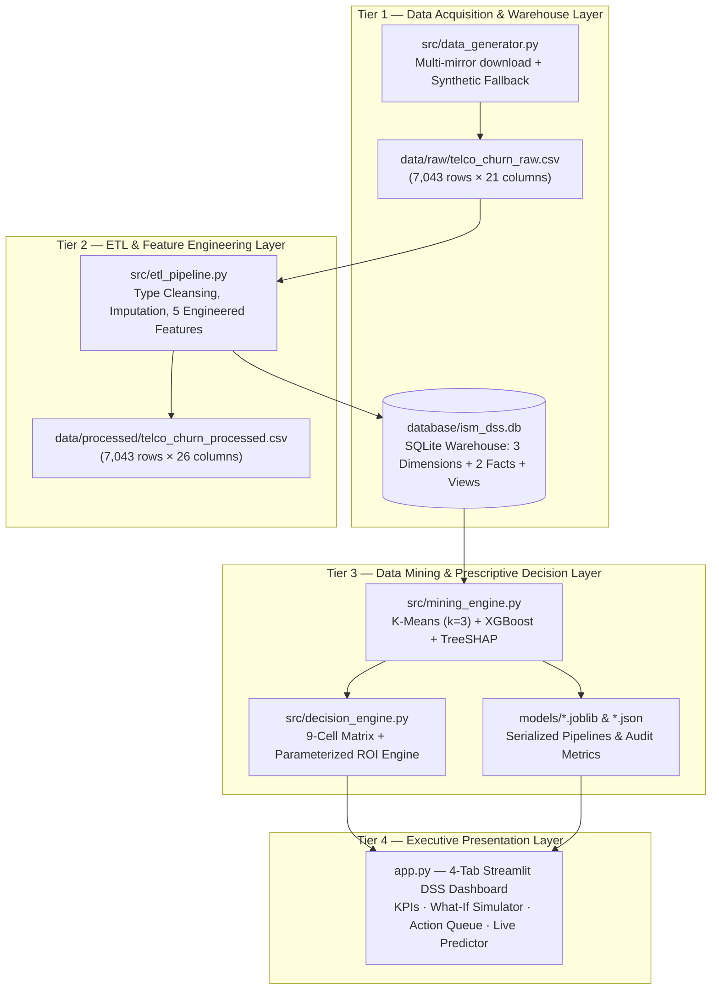

# 📘 ISM PROJECT REPORT OUTLINE & EMPIRICAL REFERENCE
## Building an Intelligent Customer Retention & Value Optimization System using Data Mining Techniques
**(K-Means Clustering + XGBoost Classification + SHAP Explainability + Prescriptive Decision Support Dashboard)**

> **Course:** Information Systems Management (ISM)  
> **Institution:** School of Computer Science and Engineering — International University, VNU-HCMC (HCMIU)  
> **System Repository:** `ISM-project` (4-Tier Decision Support System)

---

## 1. Executive Summary

Customer acquisition in the telecommunications industry costs five to seven times more than retaining an existing subscriber. However, blanket retention campaigns—where every at-risk subscriber receives an identical financial discount—erode profit margins by subsidizing low-value accounts while under-investing in high-value subscribers.

This project designs, implements, and validates an end-to-end **4-Tier Decision Support System (DSS)** on the benchmark **IBM Telco Customer Churn** dataset (**7,043 subscribers**, **26.54% observed churn rate**, **\$5,473,399.20** in total annualized revenue). The system integrates four analytical pillars:

1. **Data Warehouse & ETL Layer (`src/etl_pipeline.py`):** Cleanses raw operational records, resolves the 11 zero-tenure blank `TotalCharges` anomalies, engineers five behavioral indicators, and loads a normalized SQLite decision warehouse (`database/ism_dss.db`) featuring three 3NF dimension tables (`customers`, `services`, `billing`), two fact tables (`fact_mining_scores`, `fact_retention_actions`), and an integrated `vw_customer_360` analytical view.
2. **Unsupervised Customer Value Segmentation (`src/mining_engine.py` — Module 1):** Applies `StandardScaler` and **K-Means ($k=3$, Silhouette = `0.402`)** across `tenure`, `monthly_charges`, `total_charges`, and `total_services_count` to stratify the subscriber base into **High Value** (`2,211` accounts, 43.31% of monthly revenue), **Medium Value** (`2,708` accounts, 44.51% of revenue, 45.61% churn rate), and **Low Value** (`2,124` accounts, 12.19% of revenue).
3. **Supervised Churn Prediction & Explainable AI (`src/mining_engine.py` — Modules 2 & 3):** Trains a leakage-free `ColumnTransformer + XGBClassifier` pipeline (`scale_pos_weight = 2.7686`) on a stratified 80/20 split, achieving a hold-out **ROC-AUC of `0.8423`**, **PR-AUC of `0.6651`**, **Recall of `77.01%`**, and **F1-Score of `0.6268`**. Exact **TreeSHAP** attributions (`7,043 × 48` encoded features aggregated back to 23 business attributes) identify `contract` (`0.7832`), `tenure` (`0.4331`), `online_security` (`0.2600`), `internet_service` (`0.2146`), and `monthly_charges` (`0.2069`) as the top global churn drivers, while extracting the top two risk-increasing drivers per customer.
4. **Prescriptive Retention Decision Matrix & ROI Engine (`src/decision_engine.py` & `app.py`):** Positions all 7,043 subscribers across a **9-cell Value Tier × Churn Risk matrix** and personalizes retention offers using each subscriber's top SHAP drivers. Out of **\$2,445,852.11** in annual revenue at risk, the baseline policy selectively targets **3,100 High/Medium-Value at-risk accounts** with a total intervention budget of **\$29,292.27**, generating **\$567,861.45** in expected saved revenue, **\$538,569.18** in expected net benefit, and a **Portfolio ROI of `1,838.61%`**.

---

## 2. Business Problem & Managerial Motivation

### 2.1 Operational Challenge
Telecommunication operators operate in saturated markets characterized by low switching costs for month-to-month subscribers and intense price competition on fiber-optic bundles. In our dataset of **7,043 subscribers**:
- **1,869 subscribers (`26.54%`)** have churned.
- Early-lifecycle subscribers (`tenure_group = 0-12m`, $n = 2{,}186$) exhibit an acute churn rate of **47.4%**, compared to **9.5%** among long-tenured subscribers (`48m+`, $n = 2{,}239$).
- Total annualized recurring revenue is **\$5,473,399.20**, of which **\$2,445,852.11 (`44.69%`)** is exposed to expected annual churn risk.

### 2.2 Limitations of Traditional Retention Approaches
1. **Reactive rather than proactive:** Traditional CRM workflows trigger retention offers only when a subscriber calls to cancel service.
2. **Value-blind targeting:** Treating a \$26/month single-line subscriber identically to a \$100/month multi-service fiber subscriber leads to negative ROI on low-tier interventions.
3. **Black-box risk scores:** Providing a retention agent with a churn probability ($p = 0.83$) without explaining *why* the customer is leaving prevents tailored offer selection.

### 2.3 Research Questions & System Objectives
| Research Question | Analytical Method | Managerial Deliverable |
|---|---|---|
| **RQ1:** How should subscribers be stratified by economic importance? | Standardized K-Means Clustering ($k=3$) | Customer Value Tiers (`High`, `Medium`, `Low`) |
| **RQ2:** Which subscribers are at highest risk of churning in the next billing cycle? | Cost-sensitive XGBoost Classification | Calibrated churn probability $p_i \in [0, 1]$ and Risk Level |
| **RQ3:** Which specific contract or service attributes drive each individual's churn risk? | Exact TreeSHAP local & global attributions | Per-customer `top_shap_driver_1` & `top_shap_driver_2` |
| **RQ4:** How should a constrained retention budget be allocated to maximize net financial benefit? | 9-Cell Prescriptive Decision Matrix & What-If Simulator | Personalized action queue, expected net benefit, and ROI |

---

## 3. Four-Tier Information Systems Architecture

Following Information Systems Management (ISM) design principles, the system decouples data storage, data processing, analytical modeling, and executive presentation into four distinct tiers:

---

## 4. Data Warehouse & Hybrid 3NF / Star Schema Design (`database/ism_dss.db`)

### 4.1 Data Cleansing & Feature Engineering (`src/etl_pipeline.py`)
- **Missing-Value Resolution:** Exactly **11 records** contain whitespace in `TotalCharges`. Inspection confirms all 11 records have `tenure = 0` (newly onboarded subscribers who have not yet completed their first billing cycle). Imputing `total_charges = 0.0` preserves economic consistency without discarding records.
- **Engineered Features:**
  1. `tenure_group`: Categorizes subscriber lifecycle into `0-12m` (47.4% churn), `12-24m` (28.7% churn), `24-48m` (20.4% churn), and `48m+` (9.5% churn).
  2. `total_services_count`: Counts active subscriptions across the six value-added services (`online_security`, `online_backup`, `device_protection`, `tech_support`, `streaming_tv`, `streaming_movies`; mean = `2.04`, range `0–6`), serving as a proxy for ecosystem lock-in.
  3. `avg_monthly_spend`: Ratio `total_charges / tenure` (or `monthly_charges` when `tenure = 0`; mean = `\$64.76`).
  4. `is_auto_payment`: Binary indicator (`1` for automatic bank transfer or credit card; `43.5%` of subscribers).
  5. `churn_binary`: Numeric target (`1` = Churned, `0` = Retained).

### 4.2 Relational Warehouse Schema
The SQLite warehouse combines **Third Normal Form (3NF) dimension tables** (eliminating update anomalies across demographics, service subscriptions, and billing) with **Analytical Fact Tables** for mining scores and retention actions:

- **Dimension Tables (7,043 rows each):**
  - `customers`: `customerID` (PK), `gender`, `senior_citizen`, `partner`, `dependents`, `tenure`, `tenure_group`, `contract`, `churn`, `churn_binary`.
  - `services`: `customerID` (PK, FK), `phone_service`, `multiple_lines`, `internet_service`, 6 VAS attributes, `total_services_count`.
  - `billing`: `customerID` (PK, FK), `paperless_billing`, `payment_method`, `is_auto_payment`, `monthly_charges`, `total_charges`, `avg_monthly_spend`.
- **Fact Tables (7,043 rows each):**
  - `fact_mining_scores`: `customerID` (PK, FK), `value_tier` (`CHECK IN ('High','Medium','Low')`), `cluster_id`, `churn_probability` (`CHECK BETWEEN 0 AND 1`), `risk_level` (`CHECK IN ('High','Medium','Low')`), `top_shap_driver_1`, `top_shap_driver_2`, `scored_at`.
  - `fact_retention_actions`: `customerID` (PK, FK), `annualized_revenue`, `revenue_at_risk`, `decision_quadrant`, `recommended_action`, `intervention_cost`, `expected_saved_revenue`, `expected_net_benefit`, `expected_roi`, `decided_at`.
- **Analytical Views & Lineage:**
  - `customer_master`: Joins `customers`, `services`, and `billing` (`7,043 × 26`).
  - `vw_customer_360`: Master Customer 360° view (`7,043 × 41`) joining `customer_master` with both fact tables.
  - `etl_audit_log`: Tracks run timestamps, extracted/loaded row counts, and imputation counts across executions.

---

## 5. Data Mining Methodology & Empirical Results (`src/mining_engine.py`)

### 5.1 Module 1 — Customer Value Segmentation (K-Means Clustering)
To prevent high-magnitude monetary variables (`total_charges` up to \$8,684.80) from dominating Euclidean distance calculations, all four value indicators (`tenure`, `monthly_charges`, `total_charges`, `total_services_count`) are standardized via `StandardScaler` inside a scikit-learn `Pipeline`.

- **Cluster Validity Analysis (Silhouette Coefficient):**
  - $k=2$: `0.4586` · **$k=3$: `0.4025`** · $k=4$: `0.3955` · $k=5$: `0.3757` · $k=6$: `0.3650`.
  - $k=3$ provides strong cluster separation while mapping directly onto the three-tier executive resource allocation framework (`High`, `Medium`, `Low`).

| Value Tier | Cluster ID | Customers ($n$, %) | Mean Tenure (Months) | Mean Monthly Charges (\$) | Mean Total Charges (\$) | Mean VAS Count | Observed Churn Rate | Monthly Revenue Share |
|---|---|---|---|---|---|---|---|---|
| **High Value** | 0 | 2,211 (31.39%) | 58.39 | \$89.34 | \$5,207.53 | 3.98 | 14.74% | 43.31% |
| **Medium Value** | 2 | 2,708 (38.45%) | 15.32 | \$74.96 | \$1,143.36 | 1.89 | **45.61%** | **44.51%** |
| **Low Value** | 1 | 2,124 (30.16%) | 27.02 | \$26.17 | \$680.84 | 0.20 | 14.50% | 12.19% |

**Key Managerial Insight:** Cluster 2 (**Medium Value**) represents the single largest vulnerability: these subscribers pay high monthly bills (\$74.96/month, generating **44.51%** of monthly revenue) but are still early in their tenure (15.3 months) and suffer an alarming **45.61% churn rate**.

### 5.2 Module 2 — Supervised Churn Prediction (XGBoost Classifier)
- **Feature Engineering & Leakage Prevention:** A `ColumnTransformer` applies `OneHotEncoder(handle_unknown="ignore")` to 12 categorical attributes and `StandardScaler` to 11 numerical attributes (producing 48 encoded features), encapsulated with `XGBClassifier` (`n_estimators=400`, `max_depth=4`, `learning_rate=0.03`, `subsample=0.8`, `colsample_bytree=0.8`, `min_child_weight=3`, `reg_lambda=1.0`).
- **Class Imbalance Handling:** Stratified 80/20 split (`5,634` train / `1,409` test, `random_state=42`) with cost-sensitive weighting `scale_pos_weight = 2.7686` ($N_{\text{neg}} / N_{\text{pos}}$). Setting `scale_pos_weight > 1` intentionally prioritizes **Recall (77.01%)** over Precision (52.84%) because the financial cost of missing a churning high-value subscriber (False Negative, ~\$1,072/year) is far greater than the cost of sending a retention intervention to a loyal subscriber (False Positive, \$0.50–\$33.00).

| Evaluation Metric | Hold-Out Test Set ($n = 1{,}409$) | Managerial Interpretation |
|---|---|---|
| **ROC-AUC** | **0.8423** (Train: 0.9038) | Strong discriminative ranking across all probability cutoffs |
| **PR-AUC** | **0.6651** | Robust precision-recall trade-off under 26.54% positive class prevalence |
| **Recall (Sensitivity)** | **0.7701** (`288 / 374` churners caught) | Captures more than three-quarters of actual churners before defection |
| **Precision** | **0.5284** (`288 / 545` flagged) | Over half of flagged accounts actually churn without intervention |
| **F1-Score** | **0.6268** | Harmonic balance between precision and sensitivity |
| **Accuracy / Brier Score** | **75.66%** / **0.1612** | Well-calibrated probabilistic outputs |

### 5.3 Module 3 — Explainable AI (SHAP TreeExplainer)
To bridge predictive accuracy and prescriptive action, exact **TreeSHAP** values (in log-odds units) are computed for all 7,043 subscribers. Because one-hot encoding splits multi-category attributes across multiple columns, SHAP contributions are additively aggregated back to the **23 original business attributes** (by the linearity property of Shapley values).

| Rank | Business Attribute | Mean \|SHAP\| (Log-Odds) | Managerial Explanation |
|---|---|---|---|
| 1 | `contract` | **0.7832** | Month-to-month contracts are the single strongest driver of subscriber defection |
| 2 | `tenure` | **0.4331** | Subscribers in their first 12 months face severe onboarding churn risk |
| 3 | `online_security` | **0.2600** | Subscribers lacking OnlineSecurity have lower switching barriers |
| 4 | `internet_service` | **0.2146** | Fiber-optic subscribers exhibit elevated churn due to price/QoS sensitivity |
| 5 | `monthly_charges` | **0.2069** | Higher recurring monthly charges amplify bill-shock sensitivity |
| 6 | `tech_support` | **0.1873** | Absence of TechSupport increases frustration during technical incidents |
| 7 | `total_charges` | **0.1805** | Cumulative spend reflects long-term relationship depth |
| 8 | `payment_method` | **0.1803** | Electronic check users churn at significantly higher rates than auto-pay users |

---

## 6. Prescriptive Retention Decision Matrix & Financial ROI Analysis (`src/decision_engine.py`)

### 6.1 Nine-Cell Value × Risk Stratification
Combining the K-Means `value_tier` (`High`, `Medium`, `Low`) with the XGBoost `risk_level` (`High`: $p \ge 0.60$; `Medium`: $0.30 \le p < 0.60$; `Low`: $p < 0.30$) yields nine operational cells grouped into **six strategic decision quadrants**:

1. **Critical VIP Retention (`High Value × High Risk`, $n = 266$):** Immediate 1-on-1 Account Manager outreach (`\$5.00` call cost) + 20% 3-month loyalty discount or free 6-month VAS bundle tailored to the customer's top SHAP driver (`expected_success_rate = 45%`).
2. **Proactive VIP Care (`High Value × Medium Risk`, $n = 550$):** Proactive VIP care call (`\$5.00`) + complimentary VAS upgrade & 10% 3-month loyalty credit (`expected_success_rate = 36%`).
3. **Automated Retention Campaign (`Medium Value × High Risk`, $n = 1{,}658$):** Automated email/SMS campaign (`\$0.50`) + 10% 3-month discount voucher or 3-month VAS trial (`expected_success_rate = 25%`).
4. **Targeted Nudge (`Medium Value × Medium Risk`, $n = 626$):** Automated contract-renewal nudge (`\$0.50`) + 5% 3-month promotional voucher (`expected_success_rate = 17.5%`).
5. **No Financial Intervention (`Low Value × High/Medium Risk`, $n = 705$):** Zero-cost automated satisfaction survey and self-service FAQ email (`\$0.00` financial spend to prevent negative ROI on low-margin accounts).
6. **Champions / Nurture (`All Low-Risk Tiers`, $n = 3{,}238$):** Standard service excellence and organic cross-sell/upsell (`\$0.00` retention spend).

### 6.2 Empirical Financial Performance Across All 9 Cells
| Value Tier | Risk Level | Strategic Decision Quadrant | Customers | Mean Monthly (\$) | Mean Churn Prob | Annualized Revenue (\$) | Revenue at Risk (\$) | Intervention Cost (\$) | Expected Saved Revenue (\$) | Expected Net Benefit (\$) | Cell ROI (%) |
|---|---|---|---|---|---|---|---|---|---|---|---|
| **High** | **High** | `Critical VIP Retention` | 266 | 100.28 | 0.69 | 320,080.80 | 222,565.44 | 8,531.83 | 100,154.52 | 91,622.69 | **1,073.89%** |
| **High** | **Medium** | `Proactive VIP Care` | 550 | 96.48 | 0.45 | 636,784.80 | 284,663.12 | 8,481.04 | 102,478.81 | 93,997.77 | **1,108.33%** |
| **High** | **Low** | `Champions / Nurture (No Intervention)` | 1,395 | 84.44 | 0.11 | 1,413,580.80 | 156,456.03 | 0.00 | 0.00 | 0.00 | 0.00% |
| **Medium** | **High** | `Automated Retention Campaign` | 1,658 | 80.49 | 0.80 | 1,601,436.60 | 1,293,815.33 | 10,838.14 | 323,453.94 | 312,615.80 | **2,884.40%** |
| **Medium** | **Medium** | `Targeted Nudge` | 626 | 68.66 | 0.46 | 515,786.40 | 238,710.17 | 1,441.26 | 41,774.18 | 40,332.92 | **2,798.45%** |
| **Medium** | **Low** | `Champions / Nurture (No Intervention)` | 424 | 62.64 | 0.17 | 318,723.00 | 56,359.74 | 0.00 | 0.00 | 0.00 | 0.00% |
| **Low** | **High** | `No Financial Intervention` | 338 | 34.35 | 0.73 | 139,338.60 | 103,033.95 | 0.00 | 0.00 | 0.00 | 0.00% |
| **Low** | **Medium** | `No Financial Intervention` | 367 | 29.46 | 0.44 | 129,755.40 | 57,094.63 | 0.00 | 0.00 | 0.00 | 0.00% |
| **Low** | **Low** | `Champions / Nurture (No Intervention)` | 1,419 | 23.37 | 0.08 | 397,912.80 | 33,153.70 | 0.00 | 0.00 | 0.00 | 0.00% |
| **Total** | — | **Full Portfolio** | **7,043** | **64.76** | **0.38** | **5,473,399.20** | **2,445,852.11** | **29,292.27** | **567,861.45** | **538,569.18** | **1,838.61%** |

---

## 7. Interactive Decision Support Dashboard (`app.py`)

The presentation tier (`app.py`) provides four specialized workspaces for executive and operational users:
1. **Tab 1 — Executive KPI & Portfolio Overview:** Displays 7 portfolio KPI cards, an interactive 9-cell Value × Risk heatmap (toggleable between subscriber count and revenue at risk), a grouped bar chart comparing Revenue at Risk, Saved Revenue, and Net Benefit across decision quadrants, K-Means cluster profiles with Silhouette diagnostics, Top 12 Global SHAP drivers, and the XGBoost hold-out confusion matrix.
2. **Tab 2 — Interactive What-If ROI & Budget Simulator:** Enables managers to adjust High/Medium risk thresholds, 1-on-1 call costs, email/SMS costs, discount percentages, campaign conversion rates, and an optional **Maximum Campaign Budget Cap** (which ranks targeted accounts by expected ROI and funds the highest-return accounts first). Displays real-time deltas against the baseline policy.
3. **Tab 3 — Operational Action Queue & Customer 360 Inspector:** Filters the prioritized customer queue by decision quadrant, value tier, risk level, and minimum revenue at risk; provides one-click **CSV campaign export** for CRM/Telesales teams; and includes a **Customer 360° Inspector** with an individualized horizontal SHAP waterfall bar chart.
4. **Tab 4 — Real-Time New Customer Predictor & Decision Advisor:** Allows an agent to input a new or hypothetical subscriber's profile and immediately computes their K-Means Value Tier, XGBoost Churn Probability, Local SHAP attributions, Recommended Retention Action, and Expected ROI.

---

## 8. Managerial Implications, Limitations & Future Enhancements

### 8.1 Strategic Recommendations for Telecom Management
1. **Prioritize the "Medium-Value, High-Risk" Fiber Segment (`1,658` subscribers, \$1.29M Revenue at Risk):** These recently acquired, high-monthly-spend subscribers account for over half of total revenue at risk. Automated contract-migration vouchers and 3-month `OnlineSecurity`/`TechSupport` trials deliver the highest return (**2,884.40% ROI**).
2. **Protect High-Value VIPs with Human Concierge Outreach (`266` High-Risk + `550` Medium-Risk VIPs):** Deploying dedicated Account Managers to the 816 at-risk High-Value subscribers requires only **\$17,012.87** in budget while protecting **\$507,228.56** in annual revenue at risk and saving an expected **\$202,633.33**.
3. **Institutionalize Ecosystem Lock-In during Onboarding:** Because SHAP identifies `contract=Month-to-month`, short `tenure`, and absence of `online_security`/`tech_support` as the top churn drivers, bundling complimentary 3-month security/support add-ons during the first 12 months will structurally reduce early-lifecycle churn.

### 8.2 Methodological Limitations & Future Work
- **Observational Cross-Sectional Data:** Conversion rates (`45%` VIP call, `25%` automated campaign) are parameterized domain assumptions. In production, **Uplift Modeling (Causal ML)** and randomized **A/B retention experiments** should be deployed to estimate individual treatment effects (ITE).
- **Dynamic Temporal Signals:** Incorporating monthly call-detail records (CDRs), network latency/outage tickets, and billing complaint logs would further improve PR-AUC and early warning lead time.
