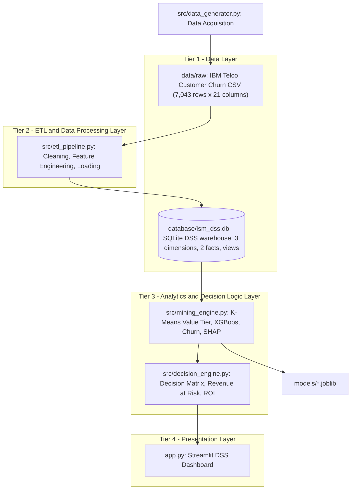
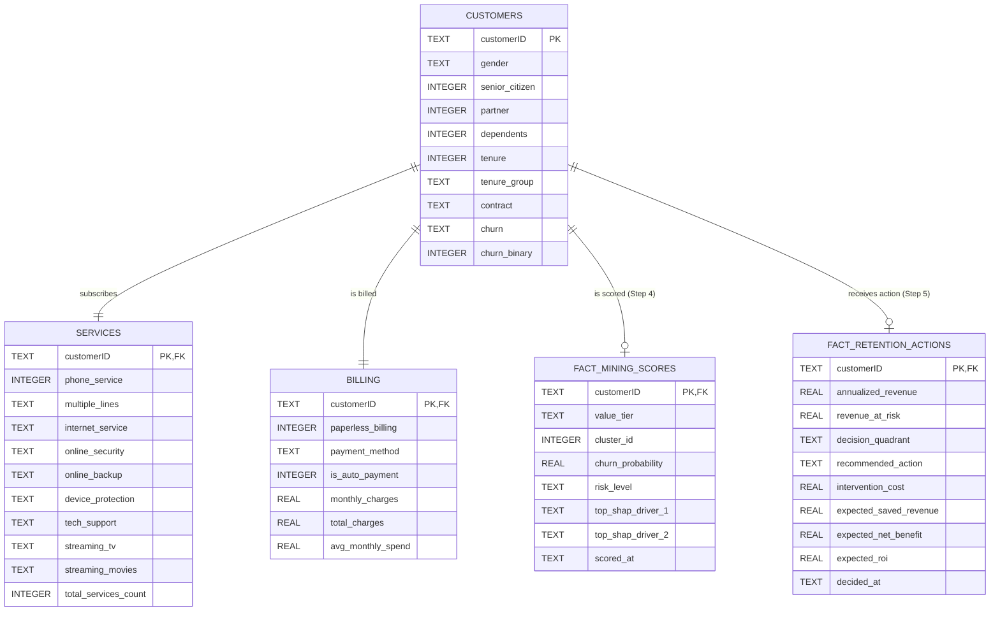

# ISM-project

## 🧠 Intelligent Customer Retention & Value Optimization System
**Using Data Mining Techniques — K-Means + XGBoost + SHAP + Decision Support Dashboard**

> Course project for **Information Systems Management (ISM)** — International University, VNU-HCMC (HCMIU).

---

## 1. Business Problem

Telecommunication providers lose a substantial share of their subscribers every month (customer churn), while retention budgets are inherently limited. Allocating retention incentives uniformly is costly and inefficient: low-value customers may receive expensive offers, whereas high-value customers at risk may be overlooked.

This Decision Support System (DSS) transforms raw customer data into actionable managerial decisions by answering three questions:

| # | Managerial Question | Data Mining Technique | Output |
|---|---------------------|-----------------------|--------|
| 1 | *Which customers are most valuable?* | **K-Means Clustering** | Customer Value Tier (High / Medium / Low) |
| 2 | *Which customers are likely to leave?* | **XGBoost Classification** | Churn probability per customer |
| 3 | *Why are they leaving and what should we do?* | **SHAP Explainability** + **Decision Matrix** | Churn drivers, recommended action, Revenue at Risk, campaign ROI |

## 2. 4-Tier ISM Architecture



| Tier | Responsibility | Components |
|------|----------------|------------|
| 1. Data Layer | Raw data acquisition and persistent relational storage | `data/raw/`, `database/ism_dss.db`, `src/data_generator.py` |
| 2. ETL Layer | Data cleaning, transformation, feature engineering, loading | `src/etl_pipeline.py`, `data/processed/` |
| 3. Analytics & Decision Layer | Segmentation, prediction, explanation, prescriptive rules | `src/mining_engine.py`, `src/decision_engine.py`, `models/` |
| 4. Presentation Layer | Interactive decision support for managers | `app.py` (Streamlit) |

## 3. Dataset

- **Source:** [IBM Telco Customer Churn](https://github.com/IBM/telco-customer-churn-on-icp4d) (also distributed on Kaggle as `WA_Fn-UseC_-Telco-Customer-Churn.csv`).
- **Size:** 7,043 customers × 21 attributes (demographics, subscribed services, account and billing information, churn label).
- **Target variable:** `Churn` (Yes = 1,869 customers, **26.54%**; No = 5,174 customers, 73.46%).
- **Known data-quality issue:** 11 records with a blank `TotalCharges` value, all corresponding to newly acquired customers with `tenure = 0`.
- **Resilience:** if all download mirrors are unreachable, `src/data_generator.py` falls back to a seeded synthetic generator that reproduces the original schema, row count, categorical domains, churn rate (~26%) and the blank-`TotalCharges` anomaly.

## 4. DSS Data Warehouse (`database/ism_dss.db`)

The ETL pipeline (`src/etl_pipeline.py`) loads the cleaned data into an SQLite warehouse designed for decision support. Three normalized **dimension tables** (3NF) describe each customer; two **fact tables** store the analytical outputs of the mining engine (Step 4) and the decision engine (Step 5). All tables share the business key `customerID`, and referential integrity is enforced through foreign keys and `CHECK` constraints.



| Object | Type | Rows | Populated by | Purpose |
|--------|------|------|--------------|---------|
| `customers` | Dimension table | 7,043 | Step 3 (ETL) | Demographics, lifecycle stage, churn outcome |
| `services` | Dimension table | 7,043 | Step 3 (ETL) | Subscribed telecom and value-added services |
| `billing` | Dimension table | 7,043 | Step 3 (ETL) | Contract billing, payment method and spending |
| `customer_master` | View | 7,043 | Step 3 (ETL) | Integrated, cleaned, analysis-ready customer record (joins the three dimensions) |
| `fact_mining_scores` | Fact table | 0 (DDL only) | Step 4 (Mining) | Value tier, cluster, churn probability, risk level, top SHAP drivers |
| `fact_retention_actions` | Fact table | 0 (DDL only) | Step 5 (Decision) | Revenue at risk, decision quadrant, recommended action, cost, net benefit, ROI |
| `vw_customer_360` | View | 7,043 | Steps 3–5 | Customer 360° view (master LEFT JOIN both fact tables) consumed by the dashboard |
| `etl_audit_log` | Audit table | 1 per run | Step 3 (ETL) | Lineage and data-quality trail of every ETL execution |

### Data Cleaning Rules
- Whitespace is stripped from all text attributes; column names are standardized to `snake_case` (business key `customerID` retained).
- The **11 blank `TotalCharges`** values belong exclusively to customers with `tenure = 0` who have not yet been billed; they are imputed with **0.0**, the economically correct cumulative charge.
- Pure Yes/No attributes (`partner`, `dependents`, `phone_service`, `paperless_billing`) are encoded as 0/1 integers; multi-category attributes are retained as text for interpretability (one-hot encoding is performed inside the modelling pipeline in Step 4).

### Engineered Features
| Feature | Table | Definition | Managerial / Analytical Rationale |
|---------|-------|------------|-----------------------------------|
| `tenure_group` | `customers` | `0-12m`, `12-24m`, `24-48m`, `48m+` | Customer lifecycle stage; churn falls from 47.4% (0-12m) to 9.5% (48m+) |
| `total_services_count` | `services` | Number of subscribed value-added services among OnlineSecurity, OnlineBackup, DeviceProtection, TechSupport, StreamingTV, StreamingMovies (0–6) | Product engagement / switching cost |
| `avg_monthly_spend` | `billing` | `total_charges / tenure` (equals `monthly_charges` when `tenure = 0`) | Historical spending level, input for value segmentation |
| `is_auto_payment` | `billing` | 1 if payment is by automatic bank transfer or credit card | Payment friction indicator |
| `churn_binary` | `customers` | 1 if `churn = 'Yes'`, otherwise 0 | Supervised learning target |

## 5. Retention Decision Matrix (Planned — Step 5)

Each customer is positioned on a **Value Tier × Churn Risk** grid. The resulting cell determines the prescribed retention action and its priority for budget allocation.

| Value Tier \ Churn Risk | **High Risk** (p ≥ 0.60) | **Medium Risk** (0.30 ≤ p < 0.60) | **Low Risk** (p < 0.30) |
|---|---|---|---|
| **High Value** | 🔴 **Priority Rescue** — dedicated account manager, premium loyalty discount, contract upgrade incentive | 🟠 **Proactive Engagement** — personalized offers, service bundle upgrade | 🟢 **Reward & Upsell** — loyalty rewards, premium cross-selling |
| **Medium Value** | 🟠 **Targeted Retention** — moderate discount, long-term contract migration | 🟡 **Nurture** — satisfaction survey, add-on service trials | 🟢 **Maintain** — standard engagement, upsell opportunities |
| **Low Value** | 🟡 **Low-Cost Retention** — automated e-mail/SMS campaigns, self-service support | ⚪ **Monitor** — automated monitoring, no paid incentives | ⚪ **No Action** — standard service |

Key decision metrics (implemented in `src/decision_engine.py`):

$$\text{Revenue at Risk}_i = p_i \times \text{MonthlyCharges}_i \times H$$

$$\text{ROI} = \frac{\sum_i p_i \cdot s \cdot \text{CLV}_i - \sum_i c_i}{\sum_i c_i}$$

where $p_i$ is the predicted churn probability, $H$ is the planning horizon in months, $s$ is the expected campaign success rate, $\text{CLV}_i$ is the customer lifetime value and $c_i$ is the intervention cost.

## 6. Project Structure

```text
./ (ISM-project)
├── data/
│   ├── raw/                  # Original IBM Telco Customer Churn dataset
│   └── processed/            # Cleaned and feature-engineered data (ETL output)
├── database/
│   └── ism_dss.db            # SQLite DSS warehouse (3 dimensions + 2 facts + views)
├── models/                   # Trained model artifacts (.joblib)
├── src/
│   ├── data_generator.py     # Dataset acquisition (synthetic fallback, 7,043 rows)
│   ├── etl_pipeline.py       # Cleaning, feature engineering and loading into SQLite
│   ├── mining_engine.py      # K-Means (Value Tier) + XGBoost (Churn) + SHAP
│   └── decision_engine.py    # Decision matrix, Revenue at Risk and ROI
├── app.py                    # Streamlit DSS dashboard
├── requirements.txt          # Python dependencies
├── PROGRESS.md               # Project progress log
└── README.md                 # Project documentation
```

## 7. Setup Instructions

**Prerequisites:** Python 3.9 or later, Git.

```powershell
# Windows (PowerShell)
git clone https://github.com/Vu-Viet-Phong/ISM-project.git
cd ISM-project
python -m venv .venv
.\.venv\Scripts\Activate.ps1
pip install -r requirements.txt
```

```bash
# macOS / Linux
git clone https://github.com/Vu-Viet-Phong/ISM-project.git
cd ISM-project
python3 -m venv .venv
source .venv/bin/activate
pip install -r requirements.txt
```

**Running the pipeline:**

```powershell
# Step 2 - Data acquisition (use --force to re-download, --synthetic to force the fallback generator)
.\.venv\Scripts\python.exe src/data_generator.py

# Step 3 - ETL: clean, engineer features, build the SQLite DSS warehouse and export the processed CSV
.\.venv\Scripts\python.exe src/etl_pipeline.py
```

*(Further pipeline commands will be added as subsequent steps are completed.)*

## 8. Progress

| Step | Description | Status |
|------|-------------|--------|
| 1 | Project Scaffolding & Environment Setup | ✅ Completed |
| 2 | Data Acquisition (`src/data_generator.py`) | ✅ Completed |
| 3 | ETL Pipeline & SQLite DSS Warehouse (`src/etl_pipeline.py`) | ✅ Completed |
| 4 | Data Mining Engine (`src/mining_engine.py`) | ⏳ Pending |
| 5 | Decision Engine (`src/decision_engine.py`) | ⏳ Pending |
| 6 | Streamlit DSS Dashboard (`app.py`) & Final Documentation | ⏳ Pending |

See [PROGRESS.md](PROGRESS.md) for the detailed progress log.

## 9. Technology Stack

Python 3.9 · pandas · NumPy · scikit-learn · XGBoost · SHAP · SQLite · Plotly · Streamlit
