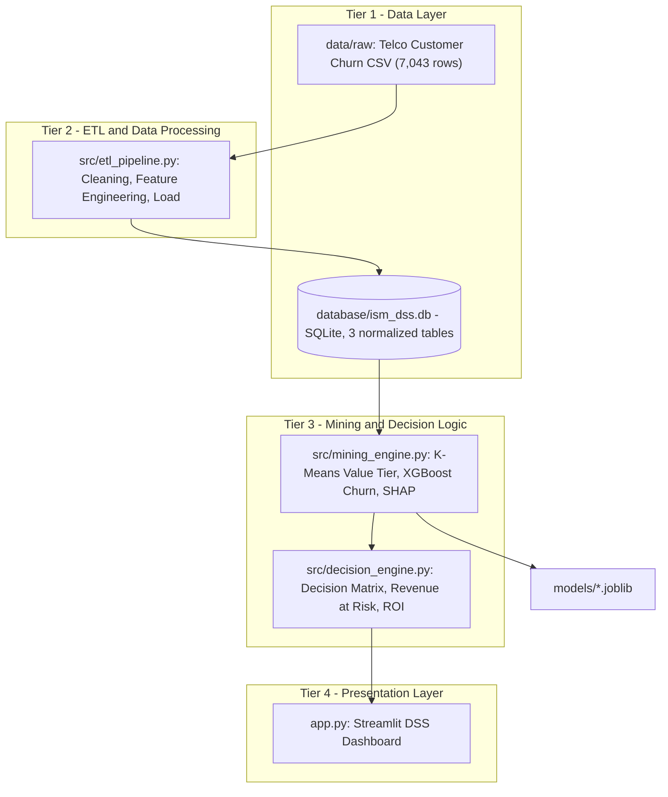

# ISM-project

## 🧠 Intelligent Customer Retention & Value Optimization System
**Using Data Mining Techniques — K-Means + XGBoost + SHAP + Decision Support Dashboard**

> Đồ án môn **Information Systems Management (ISM)** — HCMIU.

---

## 1. Bài toán kinh doanh

Doanh nghiệp viễn thông mất khách hàng (churn) mỗi tháng, nhưng ngân sách giữ chân khách hàng có hạn. Hệ thống này trả lời 3 câu hỏi quản trị:

1. **Ai có giá trị cao?** → Phân khúc khách hàng theo giá trị (Value Tier) bằng **K-Means**.
2. **Ai sắp rời bỏ?** → Dự đoán xác suất churn bằng **XGBoost**.
3. **Vì sao và nên làm gì?** → Giải thích nguyên nhân bằng **SHAP**, kết hợp **Ma trận quyết định (Value × Risk)** để đề xuất hành động, tính **Revenue at Risk** và **ROI** của chiến dịch giữ chân.

## 2. Kiến trúc hệ thống (4-Tier ISM Architecture)



## 3. Cấu trúc thư mục

```text
./ (ISM-project)
├── data/
│   ├── raw/                  # Dữ liệu gốc Telco Customer Churn
│   └── processed/            # Dữ liệu đã qua ETL
├── database/
│   └── ism_dss.db            # SQLite Database (3 bảng chuẩn hóa)
├── models/                   # Model artifacts (.joblib)
├── src/
│   ├── data_generator.py     # Tải dataset Telco Churn (fallback: sinh dữ liệu 7,043 dòng)
│   ├── etl_pipeline.py       # Làm sạch, Feature Engineering & nạp vào SQLite
│   ├── mining_engine.py      # K-Means (Value Tier) + XGBoost (Churn) + SHAP
│   └── decision_engine.py    # Ma trận quyết định & ROI / Revenue at Risk
├── app.py                    # Streamlit Dashboard
├── requirements.txt
├── PROGRESS.md               # Nhật ký tiến độ
└── README.md
```

## 4. Cài đặt môi trường

```powershell
# Windows (PowerShell)
python -m venv .venv
.\.venv\Scripts\Activate.ps1
pip install -r requirements.txt
```

```bash
# macOS / Linux
python3 -m venv .venv
source .venv/bin/activate
pip install -r requirements.txt
```

## 5. Tiến độ

| Step | Nội dung | Trạng thái |
|------|----------|-----------|
| 1 | Project Scaffolding & Environment Setup | ✅ |
| 2 | Data Acquisition (`data_generator.py`) | ⏳ |
| 3 | ETL Pipeline & SQLite DB (`etl_pipeline.py`) | ⏳ |
| 4 | Data Mining Engine (`mining_engine.py`) | ⏳ |
| 5 | Decision Engine (`decision_engine.py`) | ⏳ |
| 6 | Streamlit DSS Dashboard (`app.py`) | ⏳ |

Chi tiết xem [PROGRESS.md](PROGRESS.md).

## 6. Tech Stack

Python 3.9+ · pandas · NumPy · scikit-learn · XGBoost · SHAP · SQLite · Plotly · Streamlit
