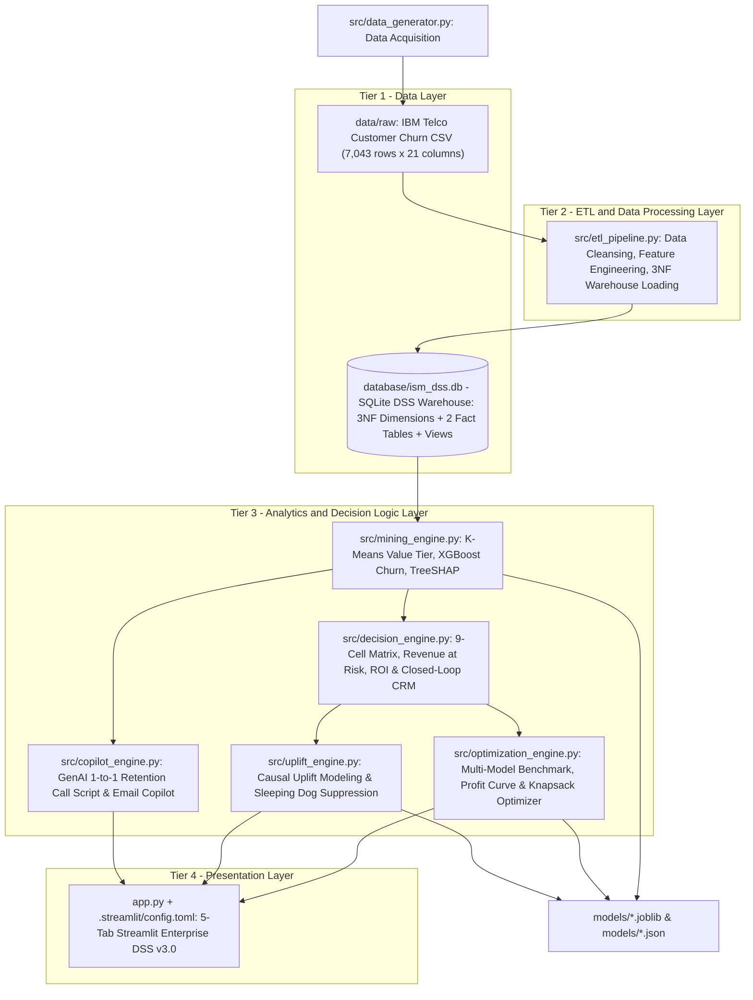
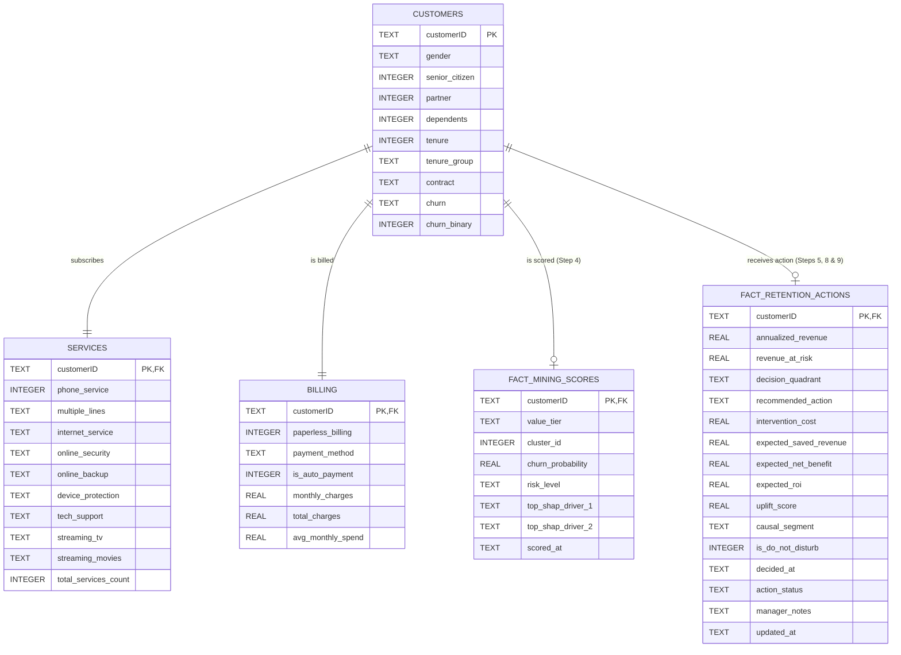
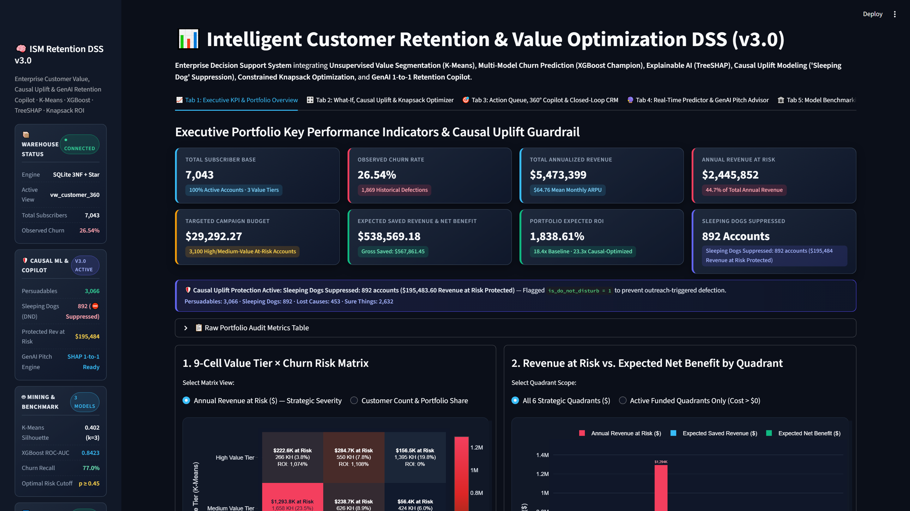
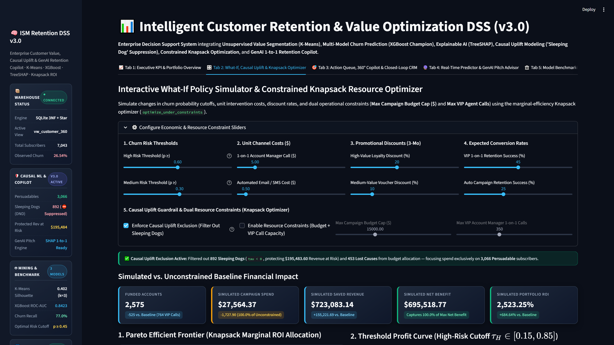
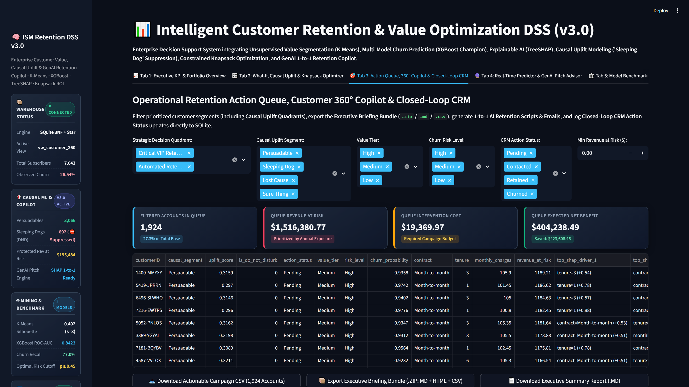
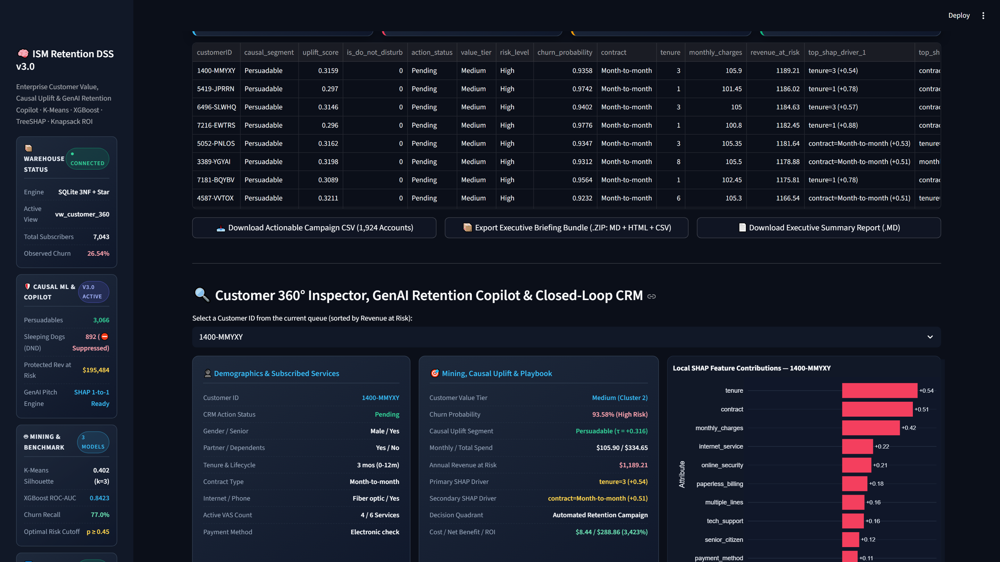
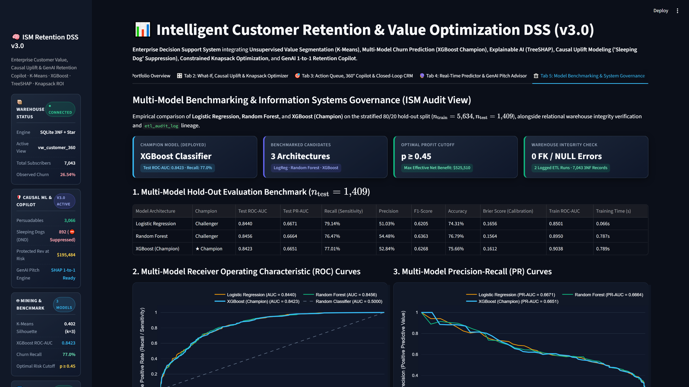

# ISM-project

## 🧠 Intelligent Customer Retention & Value Optimization System (Enterprise DSS v3.0)
**Using Data Mining, Causal Uplift Modeling & Generative AI Copilot — K-Means + XGBoost + TreeSHAP + Knapsack Optimizer + Streamlit DSS**

> **Course Project:** Information Systems Management (ISM)  
> **Group:** 6  
> **Topic:** Build an application using techniques in Data Mining  
> **Department:** School / Department of Computer Science and Engineering  
> **Institution:** International University — Vietnam National University, Ho Chi Minh City (HCMIU – VNU-HCM)  
> **Team Members:**
> 1. **ITDSIU19048** — Vũ Viết Phong
> 2. **ITDSIU19027** — Trương Đăng Khoa
> 3. **ITITIU20322** — Trần Khánh Toàn
> 4. **ITITWE23040** — Nguyễn Lê Mai Hương

---

## 1. Business Problem

Telecommunication providers lose a substantial share of their subscribers every month (customer churn), while retention budgets are inherently limited. Allocating retention incentives uniformly is costly and inefficient: low-value customers may receive expensive offers, high-value customers at risk may be overlooked, and proactive outreach to "Sleeping Dog" subscribers ($\tau < 0$) can inadvertently trigger contract cancellation.

This Enterprise Decision Support System (DSS v3.0) transforms raw subscriber data into actionable, closed-loop managerial decisions across five analytical dimensions:

| # | Managerial Question | Analytical / Data Mining Technique | DSS Output |
|---|---------------------|------------------------------------|------------|
| 1 | *Which customers are most valuable?* | **K-Means Clustering ($k=3$)** | Customer Value Tier (`High` / `Medium` / `Low`) |
| 2 | *Which customers are likely to leave?* | **Multi-Model Benchmarking & XGBoost Champion** | Calibrated churn probability $p_i \in [0, 1]$ |
| 3 | *Why are they leaving and what should we do?* | **TreeSHAP Explainability** + **9-Cell Decision Matrix** | Top local churn drivers, recommended action, Revenue at Risk, campaign ROI |
| 4 | *How do we allocate limited budget & avoid backfire churn?* | **Causal Uplift Modeling ($\tau_i$)** + **Knapsack Optimizer** | Causal segment (`Persuadable`, `Sleeping Dog`, `Lost Cause`, `Sure Thing`), `is_do_not_disturb` flag, Pareto-optimal budget allocation |
| 5 | *How should Account Managers communicate 1-to-1?* | **GenAI Contextual Retention Copilot** | Personalized 3-stage Telesales Call Script & Customer Retention Email |

## 2. 4-Tier ISM Architecture



| Tier | Responsibility | Components |
|------|----------------|------------|
| 1. Data Layer | Raw data acquisition and persistent relational/analytical storage | `data/raw/`, `database/ism_dss.db`, `src/data_generator.py` |
| 2. ETL Layer | Data cleaning, transformation, feature engineering, loading, and audit logging | `src/etl_pipeline.py`, `data/processed/` |
| 3. Analytics & Decision Layer | Segmentation, churn prediction, SHAP explainability, prescriptive ROI rules, multi-model benchmarking, constrained knapsack optimization, causal uplift modeling, and GenAI pitch synthesis | `src/mining_engine.py`, `src/decision_engine.py`, `src/optimization_engine.py`, `src/uplift_engine.py`, `src/copilot_engine.py`, `models/` |
| 4. Presentation Layer | Interactive 5-Tab Enterprise Slate Dark decision support workspace for executives and account managers | `app.py`, `.streamlit/config.toml` |

## 3. Dataset

- **Source:** [IBM Telco Customer Churn](https://github.com/IBM/telco-customer-churn-on-icp4d) (also distributed on Kaggle as `WA_Fn-UseC_-Telco-Customer-Churn.csv`).
- **Size:** 7,043 customers × 21 attributes (demographics, subscribed services, account and billing information, churn label).
- **Target variable:** `Churn` (Yes = 1,869 customers, **26.54%**; No = 5,174 customers, 73.46%).
- **Known data-quality issue:** 11 records with a blank `TotalCharges` value, all corresponding to newly acquired customers with `tenure = 0`.
- **Resilience:** if all download mirrors are unreachable, `src/data_generator.py` falls back to a seeded synthetic generator that reproduces the original schema, row count, categorical domains, churn rate (~26%) and the blank-`TotalCharges` anomaly.

## 4. DSS Data Warehouse (`database/ism_dss.db`)

The ETL pipeline (`src/etl_pipeline.py`) loads the cleaned data into an SQLite warehouse designed for decision support. Three normalized **dimension tables** (3NF) describe each customer; two **fact tables** store the analytical outputs of the mining engine (Step 4) and the decision, CRM, and causal uplift engines (Steps 5, 8 & 9). All tables share the business key `customerID`, and referential integrity is enforced through foreign keys and `CHECK` constraints.



| Object | Type | Rows | Populated by | Purpose |
|--------|------|------|--------------|---------|
| `customers` | Dimension table | 7,043 | Step 3 (ETL) | Demographics, lifecycle stage, churn outcome |
| `services` | Dimension table | 7,043 | Step 3 (ETL) | Subscribed telecom and value-added services |
| `billing` | Dimension table | 7,043 | Step 3 (ETL) | Contract billing, payment method and spending |
| `customer_master` | View | 7,043 | Step 3 (ETL) | Integrated, cleaned, analysis-ready customer record (joins the three dimensions) |
| `fact_mining_scores` | Fact table | 7,043 | Step 4 (Mining) | Value tier, cluster, churn probability, risk level, top SHAP drivers |
| `fact_retention_actions` | Fact table | 7,043 | Steps 5, 8 & 9 | Revenue at risk, decision quadrant, recommended action, cost, net benefit, ROI, Causal Uplift (`uplift_score`, `causal_segment`, `is_do_not_disturb`), and Closed-Loop CRM tracking (`action_status`, `manager_notes`, `updated_at`) |
| `vw_customer_360` | View | 7,043 | Steps 3–9 | Customer 360° view (47 columns: `customer_master` LEFT JOIN both fact tables) consumed by the dashboard |
| `etl_audit_log` | Audit table | 1 per run | Step 3 (ETL) | Lineage and data-quality trail of every ETL execution |

### Data Cleaning Rules
- Whitespace is stripped from all text attributes; column names are standardized to `snake_case` (business key `customerID` retained).
- The **11 blank `TotalCharges`** values belong exclusively to customers with `tenure = 0` who have not yet been billed; they are imputed with **0.0**, the economically correct cumulative charge.
- Pure Yes/No attributes (`partner`, `dependents`, `phone_service`, `paperless_billing`) are encoded as 0/1 integers; multi-category attributes are retained as text for interpretability (one-hot encoding is performed inside the modelling pipeline in Step 4).

### Engineered Features
| Feature | Table | Definition | Managerial / Analytical Rationale |
|---------|-------|------------|-----------------------------------|
| `tenure_group` | `customers` | `0-12m`, `12-24m`, `24-48m`, `48m+` | Customer lifecycle stage; churn falls from 47.4% (0-12m) to 9.5% (48m+) |
| `total_services_count` | `services` | Number of subscribed value-added services among OnlineSecurity, OnlineBackup, DeviceProtection, TechSupport, StreamingTV, StreamingMovies (0–6) | Product engagement / switching cost |
| `avg_monthly_spend` | `billing` | `total_charges / tenure` (equals `monthly_charges` when `tenure = 0`) | Historical spending level, input for value segmentation |
| `is_auto_payment` | `billing` | 1 if payment is by automatic bank transfer or credit card | Payment friction indicator |
| `churn_binary` | `customers` | 1 if `churn = 'Yes'`, otherwise 0 | Supervised learning target |

## 5. Data Mining Engine (`src/mining_engine.py`)

The analytics engine integrates unsupervised segmentation, supervised classification and model explainability, persisting 7,043 customer score records into `fact_mining_scores`.

### 5.1 Module 1 — Customer Value Tiering (K-Means Clustering)
Customers are segmented on standardized (`StandardScaler`) behavioral and monetary attributes: `tenure`, `monthly_charges`, `total_charges` and `total_services_count`.
- **Cluster validity (Silhouette score):** $k=2$: `0.459`, $k=3$: **`0.402`**, $k=4$: `0.396`, $k=5$: `0.376`, $k=6$: `0.365`. $k=3$ is selected to align directly with the three-tier managerial value hierarchy.
- Clusters are ordered by mean realized revenue (`total_charges`) and monthly run-rate (`monthly_charges`) and mapped to `'High'`, `'Medium'` and `'Low'`.

| Value Tier | Cluster ID | Customers | Mean Tenure (m) | Mean Monthly Charges (\$) | Mean Total Charges (\$) | Mean VAS Count | Observed Churn Rate | Monthly Revenue Share |
|------------|------------|-----------|-----------------|---------------------------|-------------------------|----------------|---------------------|-----------------------|
| **High** | 0 | 2,211 (31.4%) | 58.4 | 89.34 | 5,207.53 | 3.98 | 14.74% | 43.31% |
| **Medium** | 2 | 2,708 (38.4%) | 15.3 | 74.96 | 1,143.36 | 1.89 | 45.61% | 44.51% |
| **Low** | 1 | 2,124 (30.2%) | 27.0 | 26.17 | 680.84 | 0.20 | 14.50% | 12.19% |

### 5.2 Module 2 — Churn Prediction Model (XGBoost Classifier)
An end-to-end scikit-learn `Pipeline` (`ColumnTransformer` with `OneHotEncoder(handle_unknown="ignore")` for 12 categorical features and `StandardScaler` for 11 numerical features, followed by `XGBClassifier`) prevents data leakage and supports single-customer scoring in the dashboard.
- **Validation protocol:** Stratified 80/20 train/test split (`5,634` train / `1,409` test, `random_state=42`) with `scale_pos_weight = 2.7686` to counter the 26.54% class imbalance.

| Hold-out Test Metric | Value | Confusion Matrix (Test, $n = 1{,}409$) | Count |
|----------------------|-------|----------------------------------------|-------|
| **ROC-AUC** | **0.8423** | True Negatives (TN) | 778 |
| **PR-AUC** | **0.6651** | False Positives (FP) | 257 |
| **Recall (Sensitivity)** | **0.7701** | False Negatives (FN) | 86 |
| **Precision** | **0.5284** | True Positives (TP) | 288 |
| **F1-Score** | **0.6268** | Overall Accuracy / Brier Score | 75.66% / 0.1612 |

Customer churn probabilities $p_i \in [0, 1]$ are mapped to risk levels: **High** ($p_i \ge 0.60$), **Medium** ($0.30 \le p_i < 0.60$), and **Low** ($p_i < 0.30$).

### 5.3 Module 3 — Explainable AI (SHAP TreeExplainer)
Exact TreeSHAP values (in log-odds units) are computed across all 48 encoded features and aggregated back to the 23 original business attributes. For each customer, the two strongest risk-increasing attributes ($+\text{SHAP}$) are formatted into `top_shap_driver_1` and `top_shap_driver_2` (e.g., `tenure=1 (+0.88)`, `contract=Month-to-month (+0.61)`).

| Rank | Business Attribute | Mean \|SHAP\| (log-odds) | Primary Risk Direction |
|------|--------------------|--------------------------|------------------------|
| 1 | `contract` | **0.7832** | Month-to-month contracts strongly increase churn propensity |
| 2 | `tenure` | **0.4331** | Early-lifecycle subscribers (short tenure) face acute churn risk |
| 3 | `online_security` | **0.2600** | Absence of online security add-on increases switching likelihood |
| 4 | `internet_service` | **0.2146** | Fiber optic subscribers exhibit higher churn than DSL / no internet |
| 5 | `monthly_charges` | **0.2069** | Higher monthly bill increases price sensitivity |

### 5.4 Customer Distribution Across Value Tier × Risk Level
Cross-tabulation of all 7,043 scored customers stored in `fact_mining_scores`:

| Value Tier \ Risk Level | **High Risk** ($p \ge 0.60$) | **Medium Risk** ($0.30 \le p < 0.60$) | **Low Risk** ($p < 0.30$) | **Total** |
|-------------------------|------------------------------|---------------------------------------|---------------------------|-----------|
| **High Value** | **266** (3.8%) | 550 (7.8%) | 1,395 (19.8%) | **2,211** (31.4%) |
| **Medium Value** | **1,658** (23.5%) | 626 (8.9%) | 424 (6.0%) | **2,708** (38.4%) |
| **Low Value** | **338** (4.8%) | 367 (5.2%) | 1,419 (20.1%) | **2,124** (30.2%) |
| **Total** | **2,262** (32.1%) | **1,543** (21.9%) | **3,238** (46.0%) | **7,043** (100.0%) |

## 6. Retention Decision Matrix & ROI Optimization (`src/decision_engine.py`)

Each customer is positioned on a 9-cell **Value Tier × Churn Risk** grid (`run_decision_simulation(df, params)`). The cell determines the strategic `decision_quadrant`, while the customer's top local SHAP churn drivers (`top_shap_driver_1`, `top_shap_driver_2`) personalize the tactical `recommended_action`.

### 6.1 9-Cell Prescriptive Retention Playbook
| Value Tier \ Churn Risk | **High Risk** ($p \ge 0.60$) | **Medium Risk** ($0.30 \le p < 0.60$) | **Low Risk** ($p < 0.30$) |
|---|---|---|---|
| **High Value** | 🔴 **Critical VIP Retention** (`266` customers) — 1-on-1 Account Manager call + 20% 3-month loyalty discount / contract upgrade or free 6-month VAS bundle tailored to SHAP driver (`s = 45%`) | 🟠 **Proactive VIP Care** (`550` customers) — Proactive VIP check-in call + complimentary VAS bundle (`OnlineSecurity` / `TechSupport`) + 10% 3-month loyalty credit (`s = 36%`) | 🟢 **Champions / Nurture (No Intervention)** (`1,395` customers) — Standard service quality + organic cross-sell/upsell (`\$0` intervention) |
| **Medium Value** | 🟠 **Automated Retention Campaign** (`1,658` customers) — Automated email/SMS campaign + 10% 3-month discount voucher or 3-month VAS trial tailored to SHAP driver (`s = 25%`) | 🟡 **Targeted Nudge** (`626` customers) — Automated contract-renewal nudge + 5% 3-month voucher (`s = 17.5%`) | 🟢 **Champions / Nurture (No Intervention)** (`424` customers) — Standard service quality + organic upsell (`\$0` intervention) |
| **Low Value** | ⚪ **No Financial Intervention** (`338` customers) — Automated satisfaction survey & self-service FAQ email (`\$0` financial incentive to prevent negative ROI) | ⚪ **No Financial Intervention** (`367` customers) — Automated satisfaction survey & self-service FAQ email (`\$0` financial incentive) | 🟢 **Champions / Nurture (No Intervention)** (`1,419` customers) — Standard service (`\$0` intervention) |

### 6.2 Economic & ROI Formulation
For each customer $i$ over an annual horizon $H = 12$ months and promotional discount duration $D = 3$ months:

$$\text{Annualized Revenue}_i = \text{MonthlyCharges}_i \times H, \qquad \text{Revenue at Risk}_i = p_i \times \text{Annualized Revenue}_i$$

$$\text{Intervention Cost}_i = c_{\text{channel}, i} + s_i \times \left(\delta_i \times \text{MonthlyCharges}_i \times D\right)$$

$$\text{Expected Saved Revenue}_i = \text{Revenue at Risk}_i \times s_i, \qquad \text{Expected Net Benefit}_i = \text{Expected Saved Revenue}_i - \text{Intervention Cost}_i$$

$$\text{Expected ROI}_i\,(\%) = \frac{\text{Expected Saved Revenue}_i - \text{Intervention Cost}_i}{\text{Intervention Cost}_i} \times 100$$

where $c_{\text{channel}, i}$ is the upfront contact cost (`\$5.00` for 1-on-1 VIP calls, `\$0.50` for automated email/SMS), $\delta_i$ is the promotional discount rate, and $s_i$ is the expected retention success rate.

### 6.3 Portfolio Financial & ROI Results (Baseline Parameters)
- **Total Annualized Revenue:** `\$5,473,399.20` across `7,043` customers.
- **Total Annual Revenue at Risk:** `\$2,445,852.11` (**44.69%** of annual revenue).
- **Targeted Customers ($\text{Cost} > \$0$):** `3,100` customers (**Total Intervention Budget:** `\$29,292.27`).
- **Total Expected Saved Revenue:** `\$567,861.45` $\rightarrow$ **Expected Net Benefit:** `\$538,569.18` (**Portfolio ROI: `1,838.61%`**).

| Value Tier | Risk Level | Strategic Decision Quadrant | Customers | Mean Monthly (\$) | Mean Churn Prob | Annualized Revenue (\$) | Revenue at Risk (\$) | Intervention Cost (\$) | Expected Saved Revenue (\$) | Expected Net Benefit (\$) | Cell ROI (%) |
|---|---|---|---|---|---|---|---|---|---|---|---|
| **High** | **High** | `Critical VIP Retention` | 266 | 100.28 | 0.69 | 320,080.80 | 222,565.44 | 8,531.83 | 100,154.52 | 91,622.69 | **1,073.89%** |
| **High** | **Medium** | `Proactive VIP Care` | 550 | 96.48 | 0.45 | 636,784.80 | 284,663.12 | 8,481.04 | 102,478.81 | 93,997.77 | **1,108.33%** |
| **High** | **Low** | `Champions / Nurture (No Intervention)` | 1,395 | 84.44 | 0.11 | 1,413,580.80 | 156,456.03 | 0.00 | 0.00 | 0.00 | 0.00% |
| **Medium** | **High** | `Automated Retention Campaign` | 1,658 | 80.49 | 0.80 | 1,601,436.60 | 1,293,815.33 | 10,838.14 | 323,453.94 | 312,615.80 | **2,884.40%** |
| **Medium** | **Medium** | `Targeted Nudge` | 626 | 68.66 | 0.46 | 515,786.40 | 238,710.17 | 1,441.26 | 41,774.18 | 40,332.92 | **2,798.45%** |
| **Medium** | **Low** | `Champions / Nurture (No Intervention)` | 424 | 62.64 | 0.17 | 318,723.00 | 56,359.74 | 0.00 | 0.00 | 0.00 | 0.00% |
| **Low** | **High** | `No Financial Intervention` | 338 | 34.35 | 0.73 | 139,338.60 | 103,033.95 | 0.00 | 0.00 | 0.00 | 0.00% |
| **Low** | **Medium** | `No Financial Intervention` | 367 | 29.46 | 0.44 | 129,755.40 | 57,094.63 | 0.00 | 0.00 | 0.00 | 0.00% |
| **Low** | **Low** | `Champions / Nurture (No Intervention)` | 1,419 | 23.37 | 0.08 | 397,912.80 | 33,153.70 | 0.00 | 0.00 | 0.00 | 0.00% |
| **Total** | — | **All Portfolio** | **7,043** | **64.76** | **0.38** | **5,473,399.20** | **2,445,852.11** | **29,292.27** | **567,861.45** | **538,569.18** | **1,838.61%** |

## 7. Enterprise DSS v2.0 Extensions: Benchmarking, Profit Curve & Constrained Optimizer (`src/optimization_engine.py`)

### 7.1 Multi-Model Benchmarking (Stratified 80/20 Hold-Out Split, $n = 1{,}409$)
Three supervised classifiers are evaluated on the exact same preprocessed feature space (`ColumnTransformer` producing 48 encoded features):

| Model | ROC-AUC (Test) | PR-AUC (Test) | Recall | Precision | F1-Score | Accuracy | Brier Score | Training Time (s) | Role in DSS |
|---|---|---|---|---|---|---|---|---|---|
| **Logistic Regression** | 0.8440 | **0.6671** | **0.7914** | 0.5103 | 0.6205 | 0.7431 | 0.1656 | **0.066** | Fast interpretable linear baseline |
| **Random Forest** | **0.8456** | 0.6664 | 0.7647 | **0.5448** | **0.6363** | **0.7679** | **0.1564** | 0.787 | Low-variance bagging benchmark |
| **XGBoost (Champion)** | 0.8423 | 0.6651 | 0.7701 | 0.5284 | 0.6268 | 0.7566 | 0.1612 | 0.789 | Deployed champion with exact `TreeSHAP` log-odds attributions |

### 7.2 Threshold Profit Curve Optimization (`0.15` to `0.85`)
Sweeping `high_risk_threshold` ($\tau_H \in [0.15, 0.85]$, step `0.05`) under an operational churn-prevention model (accounting for False Positive discount cannibalization among loyal subscribers and VIP agent capacity overload) reveals a concave profit curve that peaks at **`high_risk_threshold = 0.45`**:
- **Optimal Financial Threshold ($\tau_H^* = 0.45$, $\tau_M^* = 0.29$):** Targets `3,137` accounts (`835` VIP calls), achieving the maximum **Expected Net Benefit of `\$525,510.25`** (`\$603,502.53` saved revenue against `\$77,992.28` effective cost; `673.80%` effective ROI).
- **Conservative Baseline ($\tau_H = 0.60$):** Achieves `\$499,933.88` effective net benefit (`\$538,569.18` direct net benefit) with a higher percentage ROI (`934.22%` effective / `1,838.61%` direct).

### 7.3 Constrained Resource Allocation (Knapsack / Greedy Marginal ROI Optimizer)
When retention operations face strict budget and human-agent capacity limits (`optimize_under_constraints(sim_df, max_budget, max_vip_calls)`), eligible accounts are ranked by their marginal return ratio (`expected_net_benefit / intervention_cost`):
- **Reference Constrained Scenario (`max_budget = \$10,000`, `max_vip_calls = 150`):**
  - Funds **1,756 accounts** out of 3,100 eligible candidates (`\$9,999.99` spent = **34.14%** of the unconstrained `\$29,292.27` budget).
  - Captures **\$301,924.28 in Expected Net Benefit** (**56.06%** of total unconstrained net benefit) and **\$311,924.27 in Expected Saved Revenue**, achieving an exceptional **Constrained Portfolio ROI of `3,019.25%`**.

## 8. Enterprise DSS v3.0 Extensions: Causal Uplift Modeling & GenAI Retention Copilot (`src/uplift_engine.py`, `src/copilot_engine.py`)

### 8.1 Causal Uplift Modeling & "Sleeping Dog" Suppression (`src/uplift_engine.py`)
Whereas traditional churn models prioritize customers purely by correlational defection probability $P(\text{Churn} \mid X_i)$, **Enterprise DSS v3.0** evaluates the **Individual Treatment Effect (Causal Uplift Score)**:

$$\tau_i = P(\text{Stay} \mid T = 1, X_i) - P(\text{Stay} \mid T = 0, X_i)$$

All 7,043 subscribers in `fact_retention_actions` (`vw_customer_360`) are classified into four canonical causal quadrants:
1. **`Persuadable` ($\tau_i > 0.15$, $n = 3{,}066$):** Customers with medium-to-high churn risk who respond positively to proactive contract upgrades, loyalty discounts, and value-added service (VAS) bundles.
2. **`Sleeping Dog` ($\tau_i < 0.0$, $n = 892$, `is_do_not_disturb = 1`):** Subscribers on flexible month-to-month plans with passive billing inertia where an unsolicited marketing call or contract-renewal pitch triggers price scrutiny and accelerates cancellation (**\$195,483.60 in Annual Revenue at Risk Protected** by suppressing outbound outreach).
3. **`Lost Cause` ($P(\text{Churn}) > 0.85$ with extreme early-tenure friction, $n = 453$):** Accounts with near-zero treatment responsiveness ($\bar{\tau} = +0.0247$) where paid retention incentives yield negative return (`intervention_cost = \$0.00`).
4. **`Sure Thing` ($P(\text{Churn}) < 0.20$ or locked-in multi-year contracts, $n = 2{,}632$):** Naturally loyal subscribers requiring zero financial intervention (`intervention_cost = \$0.00`).

Enforcing **Causal Uplift Exclusion** reduces wasted campaign spend from `\$29,292.27` to `\$25,803.00`, boosts **Expected Net Benefit from `\$538,569.18` to `\$600,280.55` (`+\$61,711.37` lift)**, and increases **Portfolio ROI from `1,838.61%` to `2,326.40%` (`+487.8` percentage points)**.

### 8.2 GenAI 1-to-1 Retention Copilot (`src/copilot_engine.py`)
For any selected subscriber in **Tab 3 (Customer 360° Inspector)** or **Tab 4 (Real-Time Predictor)**, `generate_retention_pitch(customer_row)` synthesizes a hyper-personalized dual-channel communication package:
- **Tab A — Account Manager Telesales Call Script:** Structured into (1) *Personalized Opening Hook* referencing exact `tenure`, `monthly_charges`, and `value_tier`, (2) *TreeSHAP Empathy & Objection Handling* directly addressing `top_shap_driver_1` and `top_shap_driver_2`, and (3) *Tailored Retention Incentive & Close* (or an automatic **⛔ DO NOT DISTURB Inbound-Only Care Protocol** if `causal_segment == 'Sleeping Dog'`).
- **Tab B — Personalized Customer Retention Email:** Ready-to-send Markdown email with a dynamic `subject_line`, customized loyalty discount calculation, and complimentary trials for missing value-added services (`OnlineSecurity`, `TechSupport`, `OnlineBackup`, `DeviceProtection`).

## 9. Interactive Streamlit DSS Dashboard v3.0 (`app.py`)

Styled with a **Modern Enterprise Slate Dark Theme** (`.streamlit/config.toml` + custom FinTech KPI & Status cards), the Presentation Layer (`app.py`) connects directly to `vw_customer_360` (`47` columns) in `database/ism_dss.db` and the trained artifacts in `models/`, providing **five specialized decision-support workspaces**:

| Tab | Workspace Title | Key Capabilities |
|-----|-----------------|------------------|
| **Tab 1** | **Executive KPI & Portfolio Overview** | 8 high-contrast dark slate KPI cards (including **Sleeping Dogs Suppressed: `892` accounts / `\$195,484` Revenue at Risk Protected**) + Causal Guardrail status banner; semantically color-coded 9-cell Value × Risk heatmap; Revenue at Risk vs. Net Benefit bar chart by quadrant; K-Means cluster profiles & Silhouette curve; Top 12 Global SHAP bar chart; XGBoost hold-out metrics & confusion matrix |
| **Tab 2** | **What-If, Causal Uplift & Knapsack Optimizer** | Includes the **`"Enforce Causal Uplift Exclusion (Filter Out Sleeping Dogs)"`** switch alongside sensitivity sliders for risk cutoffs, channel costs, discount rates, conversion rates, and dual resource constraints (**Max Budget Cap** & **Max VIP Calls**); dynamic **Pareto Efficient Frontier** and **Threshold Profit Curve** (`0.15..0.85`, optimal $\tau_H^* = 0.45$) |
| **Tab 3** | **Action Queue, 360° Copilot & Closed-Loop CRM** | Multi-dimensional filters including **`Causal Uplift Segment`** (`Persuadable`, `Sleeping Dog`, `Lost Cause`, `Sure Thing`); **`⛔ DO NOT DISTURB` red warning alert** on Sleeping Dog records; **`"🤖 Generate AI Retention Script & Email"`** dual-tab Copilot (`Telesales Call Script` + `Personalized Customer Email` with `.md` download); **Executive Briefing Bundle Exporter (`.zip`)**; live **Closed-Loop CRM Action Logger** persisted to SQLite |
| **Tab 4** | **Real-Time Predictor & GenAI Pitch Advisor** | Interactive form for new subscriber attributes; executes live K-Means value tiering, XGBoost churn scoring, **Causal Uplift Segment & $\tau$ estimation**, local TreeSHAP waterfall, and **auto-generated 1-to-1 AI Telesales Script & Customer Email draft** |
| **Tab 5** | **Model Benchmarking & System Governance** | Multi-model evaluation benchmark table & overlaid ROC / Precision-Recall curves (**Logistic Regression** vs. **Random Forest** vs. **XGBoost Champion**); relational warehouse integrity summary; live `etl_audit_log` lineage table and Closed-Loop CRM status breakdown |

### 9.1 Dashboard Visual Preview (1920 × 1080 Enterprise Slate Dark Theme)

#### Tab 1 — Executive KPI, Causal Uplift Guardrail & Portfolio Overview


#### Tab 2 — Interactive What-If, Causal Uplift Exclusion & Knapsack Resource Optimizer


#### Tab 3 (Part A) — Operational Retention Action Queue & Multi-Dimensional Filters


#### Tab 3 (Part B) — Customer 360° Inspector & GenAI 1-to-1 Retention Copilot Playbook


#### Tab 5 — Multi-Model Benchmarking & System Governance (ISM Audit View)


## 10. Project Structure

```text
./ (ISM-project)
├── .streamlit/
│   └── config.toml           # Modern Enterprise Slate Dark Theme configuration
├── data/
│   ├── raw/                  # Original IBM Telco Customer Churn dataset (7,043 x 21)
│   └── processed/            # Cleaned and feature-engineered data (7,043 x 26)
├── database/
│   └── ism_dss.db            # SQLite DSS warehouse (3 dimensions + 2 facts + views, 47 cols in vw_customer_360)
├── docs/
│   └── screenshots/          # Automated 1920x1080 Playwright dashboard screenshots
│       ├── tab1_executive_portfolio.png
│       ├── tab2_knapsack_optimizer.png
│       ├── tab3_operational_queue.png
│       ├── tab3_genai_copilot_script.png
│       └── tab5_system_governance.png
├── models/                   # Trained model, optimization & causal uplift artifacts (.joblib, .json)
│   ├── kmeans_value_pipeline.joblib
│   ├── xgb_churn_pipeline.joblib
│   ├── shap_metadata.joblib
│   ├── model_metrics.json
│   ├── decision_summary.json
│   ├── model_benchmark.json
│   ├── threshold_profit_curve.json
│   └── uplift_summary.json
├── scripts/
│   └── capture_dashboard.py  # Automated headless Playwright screenshot utility
├── src/
│   ├── data_generator.py       # Dataset acquisition (synthetic fallback, 7,043 rows)
│   ├── etl_pipeline.py         # Cleaning, feature engineering and loading into SQLite
│   ├── mining_engine.py        # K-Means (Value Tier) + XGBoost (Churn) + SHAP
│   ├── decision_engine.py      # Decision matrix, Revenue at Risk, ROI & CRM persistence
│   ├── optimization_engine.py  # Multi-model benchmark, profit curve & knapsack optimizer
│   ├── uplift_engine.py        # Causal uplift modeling & 'Sleeping Dog' suppression
│   └── copilot_engine.py       # GenAI 1-to-1 Retention Telesales Script & Email Copilot
├── app.py                    # Streamlit DSS v3.0 dashboard (Presentation Layer)
├── ISM_REPORT_OUTLINE.md     # Full academic report outline & empirical reference
├── requirements.txt          # Python dependencies
├── PROGRESS.md               # Project progress log
└── README.md                 # Project documentation
```

## 11. Setup & Execution Instructions

**Prerequisites:** Python 3.9 or later, Git.

```powershell
# Windows (PowerShell)
git clone https://github.com/Vu-Viet-Phong/ISM-project.git
cd ISM-project
python -m venv .venv
.\.venv\Scripts\Activate.ps1
pip install -r requirements.txt
```

```bash
# macOS / Linux
git clone https://github.com/Vu-Viet-Phong/ISM-project.git
cd ISM-project
python3 -m venv .venv
source .venv/bin/activate
pip install -r requirements.txt
```

**Running the complete pipeline and launching the DSS Dashboard:**

```powershell
# Step 2 - Data acquisition (use --force to re-download, --synthetic to force the fallback generator)
.\.venv\Scripts\python.exe src/data_generator.py

# Step 3 - ETL: clean, engineer features, build the SQLite DSS warehouse and export the processed CSV
.\.venv\Scripts\python.exe src/etl_pipeline.py

# Step 4 - Data mining: train K-Means + XGBoost, compute SHAP drivers and populate fact_mining_scores
.\.venv\Scripts\python.exe src/mining_engine.py

# Step 5 - Decision engine: evaluate 9-cell retention matrix, ROI and populate fact_retention_actions
.\.venv\Scripts\python.exe src/decision_engine.py

# Step 7 - Enterprise v2.0 Optimization: multi-model benchmark, profit curve & knapsack optimizer
.\.venv\Scripts\python.exe src/optimization_engine.py

# Step 9 - Enterprise v3.0 Causal Uplift & Sleeping Dog Suppression Engine
.\.venv\Scripts\python.exe -m src.uplift_engine

# Launch the interactive Streamlit Decision Support Dashboard v3.0
.\.venv\Scripts\streamlit.exe run app.py
```

Once the Streamlit server starts, open your browser and navigate to:
👉 **`http://localhost:8501`**

## 12. Progress

| Step | Description | Status |
|------|-------------|--------|
| 1 | Project Scaffolding & Environment Setup | ✅ Completed |
| 2 | Data Acquisition (`src/data_generator.py`) | ✅ Completed |
| 3 | ETL Pipeline & SQLite DSS Warehouse (`src/etl_pipeline.py`) | ✅ Completed |
| 4 | Data Mining Engine (`src/mining_engine.py`) | ✅ Completed |
| 5 | Decision Engine (`src/decision_engine.py`) | ✅ Completed |
| 6 | Streamlit DSS Dashboard v1.0 (`app.py`) & Academic Report Outline (`ISM_REPORT_OUTLINE.md`) | ✅ Completed |
| 7 | Multi-Model Benchmarking, Profit Curve & Constrained Optimizer (`src/optimization_engine.py`) | ✅ Completed |
| 8 | Closed-Loop CRM Tracking, Executive Report Exporter & Dashboard v2.0 Upgrade (`app.py`) | ✅ Completed |
| 9 | Enterprise DSS v3.0: Causal Uplift Modeling (`src/uplift_engine.py`) & GenAI Retention Copilot (`src/copilot_engine.py`) | ✅ Completed |

See [PROGRESS.md](PROGRESS.md) for the detailed progress log and [ISM_REPORT_OUTLINE.md](ISM_REPORT_OUTLINE.md) for the comprehensive academic report outline.

## 13. Technology Stack

| Architectural Layer | Technologies & Libraries | Primary Role in ISM DSS v3.0 |
|---------------------|--------------------------|------------------------------|
| **Core & Data Layer** | Python 3.9, SQLite 3, SQLAlchemy, pandas, NumPy | Relational 3NF + Star-schema data warehousing (`database/ism_dss.db`), vectorized ETL processing, and closed-loop CRM persistence |
| **Data Mining & Analytics Layer** | scikit-learn, XGBoost, SHAP (`TreeExplainer`), Causal Uplift Modeling, GenAI Contextual Template Engine | Unsupervised value segmentation ($k=3$), multi-model churn classification, exact Shapley log-odds attribution, causal treatment uplift ($\tau_i$) & "Sleeping Dog" suppression, and 1-to-1 script/email synthesis |
| **Optimization & Persistence** | Knapsack / Greedy Marginal ROI Algorithm, Joblib, JSON | Constrained budget & VIP agent call allocation (`Pareto Efficient Frontier`), threshold profit curve sweep, and model serialization |
| **Presentation & Web Layer** | Streamlit, Plotly, HTML5 & Custom CSS3 (Flexbox Responsive Equal-Height Grid) | Interactive 5-Tab Enterprise Slate Dark dashboard (`app.py`, `.streamlit/config.toml`), dynamic What-If simulation, and Executive Briefing bundle export (`.zip`) |
| **Documentation & Architecture** | Mermaid.js, GitHub-Flavored Markdown, Git / GitHub | 4-Tier architectural flowcharts, Entity-Relationship Diagrams (ERD), academic report documentation, and version control |
